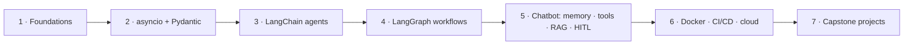

# Agentic AI: From LLMs to Production Multi-Agent Systems

Agentic AI materials for building production-ready multi-agent systems and automating workflows with **LangChain** and **LangGraph**. This is a single-repo learning track built around one course, [**Agentic AI – Complete Course for Beginners**](https://www.youtube.com/watch?v=Zy7EXDONlTY) (freeCodeCamp.org, taught by Boktiar Ahmed Bappy, ~24 h). It goes from *"what is an agent?"* to a **tool-using, RAG-enabled, human-in-the-loop chatbot deployed with CI/CD**, then two capstone projects.

---

## Table of contents

- [Main course](#main-course)
- [Repository structure](#repository-structure)
- [Conventions](#conventions)
- [Getting started](#getting-started)
- [Capstone projects](#capstone-projects)
- [License](#license)

---

## Main course

| Phase | Theme | Notes | Code |
|---|---|---|---|
| 1 | Foundations: LLM → RAG → agent; characteristics & components | [00](docs/notes/00-introduction-and-planning.md) – [02](docs/notes/02-agentic-ai-characteristics-and-components.md) | — |
| 2 | Python for agents: `asyncio`, Pydantic | [03](docs/notes/03-asynchronous-programming.md) – [04](docs/notes/04-pydantic-data-validation.md) | [`01-async-programming/`](src/01-async-programming/) · [`02-pydantic/`](src/02-pydantic/) |
| 3 | LangChain agents: single ReAct agent, multi-agent research pipeline | [05](docs/notes/05-langchain-single-agent.md) – [06](docs/notes/06-langchain-multi-agent.md) | [`03-langchain-single-agent/`](src/03-langchain-single-agent/) · [`04-langchain-multi-agent/`](src/04-langchain-multi-agent/) |
| 4 | LangGraph: state, nodes, edges, reducers; sequential · parallel · conditional · iterative | [07](docs/notes/07-langchain-vs-langgraph.md) – [12](docs/notes/12-iterative-workflows.md) | [`05-langgraph-workflows/`](src/05-langgraph-workflows/) |
| 5 | Agentic chatbot: persistence, streaming, threads, SQLite, LangSmith, tools, RAG, HITL | [13](docs/notes/13-first-agentic-chatbot.md) – [21](docs/notes/21-human-in-the-loop.md) | [`06-agentic-chatbot/`](src/06-agentic-chatbot/) |
| 6 | Deployment: Docker, GitHub Actions CI/CD on AWS EC2, Render | [22](docs/notes/22-cicd-deployment-aws.md) – [23](docs/notes/23-deployment-render.md) | external deploy repo |
| 7 | Capstones: BappyGPT, TripMate AI | [24](docs/notes/24-project-bappygpt.md) – [25](docs/notes/25-project-tripmate-ai.md) | external project repos |
| + | Beyond the video: subgraphs, guardrails, agent evaluation, LLM gateway, advanced RAG (CRAG, Self-RAG, Agentic, Graph, Multimodal) | module READMEs | [`05-langgraph-workflows/`](src/05-langgraph-workflows/) · [`07-advanced-rag/`](src/07-advanced-rag/) |

> [!IMPORTANT]
> Full session index with timestamps: [`docs/notes/README.md`](docs/notes/README.md).



## Repository structure

```
agentic-ai/
├── README.md
├── LICENSE
├── NOTICE                          # attribution for course-derived code & assets
├── .gitignore
├── .editorconfig
│
├── docs/
│   ├── notes/                      # one note per video chapter (00–25) + index
│   ├── slides/                     # course PDFs (async, GraphRAG, multimodal RAG)
│   ├── diagrams/                   # Excalidraw architecture diagrams (VS Code: Excalidraw extension)
│   └── interview-prep/             # agentic-AI interview & résumé guides (PDF)
│
└── src/                            # course code, one folder per module; each has README · requirements.txt · .env.example
    ├── 01-async-programming/
    ├── 02-pydantic/
    ├── 03-langchain-single-agent/
    ├── 04-langchain-multi-agent/
    ├── 05-langgraph-workflows/     # notebooks 1–13 + evaluation + LLM gateway
    ├── 06-agentic-chatbot/         # stage-by-stage Streamlit chatbot (backend_*.py + app_*.py)
    └── 07-advanced-rag/            # corrective · self · agentic · graph · multimodal RAG
```

> [!NOTE]
> Deployment files (chapters 22–23) and the two capstones live in the instructor's separate repos: [Agentic-Chatbot-using-LangGraph](https://github.com/entbappy/Agentic-Chatbot-using-LangGraph) · [BappyGPT](https://github.com/entbappy/BappyGPT) · [TripMate-AI](https://github.com/entbappy/TripMate-AI-A-Multi-Agent-Travel-Planner-with-LangGraph). The notes walk through them, but they are not vendored here.

## Conventions

| Topic | Rule |
|---|---|
| Notes | `docs/notes/NN-kebab-title.md`, where `NN` is the chapter number. Each starts with a **Video · Code · Diagram** header line and ends with numbered **References** |
| Code folders | `src/NN-module/`, numbered in course order. Upstream file names kept so they match the video |
| Environments | **One conda env per module.** Pinned versions differ (LangChain 0.1.x in `03`, 1.x elsewhere) |
| Secrets | Only `.env.example` (empty values) is committed. Copy it to `.env`, which `.gitignore` excludes |
| Runtime artifacts | `chatbot.db*`, `faiss_db/`, `chroma_db/`, `*.pkl`, `__pycache__/` are git-ignored and rebuilt on first run |
| Callouts | GitHub `> [!NOTE]` / `[!TIP]` / `[!IMPORTANT]` / `[!WARNING]` / `[!CAUTION]`; diagrams in Mermaid |

## Getting started

```bash
git clone <this-repo> && cd agentic-ai

# pick a module, e.g. the final chatbot
cd src/06-agentic-chatbot
conda create -n langgraph-test python=3.11 -y && conda activate langgraph-test
pip install -r requirements.txt
cp .env.example .env            # fill in the keys you need
streamlit run app_hitl.py
```

| Key | Used by | Get it |
|---|---|---|
| `OPENAI_API_KEY` | 03, 04, 05 (1–8), 06 (stages 1–3), CRAG, Self-RAG | platform.openai.com |
| `GOOGLE_API_KEY` | 05 (9–12), 06 (stages 4–7) — free tier | aistudio.google.com |
| `GROQ_API_KEY` | guardrails, evaluation, agentic / graph / multimodal RAG — free tier | console.groq.com |
| `TAVILY_API_KEY` | web search tools | tavily.com |
| `OPENWEATHER_API_KEY` · `ALPHAVANTAGE_API_KEY` · `WEATHERSTACK_API_KEY` | weather / stock tools | provider dashboards |
| `PINECONE_API_KEY` · `NEO4J_*` | advanced RAG | pinecone.io · neo4j.com/aura |
| `LANGSMITH_*` | tracing (optional) | smith.langchain.com |

> [!TIP]
> Open `.excalidraw` files with the **Excalidraw** VS Code extension, and `chatbot.db` with **SQLite Viewer**.

## Capstone projects

The course ends with three end-to-end systems that pull every phase together:

- **Agentic Chatbot** ([13](docs/notes/13-first-agentic-chatbot.md)–[23](docs/notes/23-deployment-render.md)): LangGraph + Streamlit, SQLite memory, threads, LangSmith, tools, FAISS RAG, HITL stock purchase, CI/CD to AWS and Render.
- **BappyGPT** ([24](docs/notes/24-project-bappygpt.md)): a ChatGPT clone on FastAPI + HTML/JS with Gemini, Chroma RAG, SQLAlchemy long-term memory, voice input, ECR + EC2 CI/CD.
- **TripMate AI** ([25](docs/notes/25-project-tripmate-ai.md)): a four-agent travel planner (flight → hotel → itinerary → report) with Groq Llama 3.3, Tavily, AviationStack, Postgres checkpointer on Render, FastAPI.

## License

The notes in `docs/notes/` are my own write-ups of publicly taught material and are released under the [Apache 2.0 License](LICENSE). The code in `src/` and the files in `docs/slides`, `docs/diagrams` and `docs/interview-prep` come from the instructor's course repository [entbappy/Complete-Agentic-AI-Course](https://github.com/entbappy/Complete-Agentic-AI-Course) and remain the work of their original author. See [NOTICE](NOTICE). The course content belongs to its instructor and freeCodeCamp.org.
