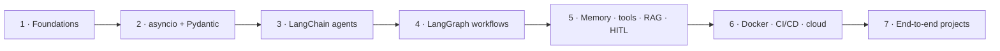

# 00 · Introduction & Planning

## Agentic AI introduction

The previous generation of GenAI apps (LLM chat, RAG) answered a prompt and stopped. An **agent** takes a prompt as a *goal*, breaks it into tasks, and finishes those tasks by **choosing its own tools**. The workflow is automated end to end, and a human only steps in where needed.

> [!NOTE]
> Course focus: **LangGraph** as the agent framework. **LangChain** is still used for the utility layer (loading LLMs, prompt templates, loaders).

---

## Course plan: seven phases

| Phase | Theme | What gets covered | Notes |
|---|---|---|---|
| 1 | Foundations | What agentic AI is, LLM app vs agent, reasoning · planning · memory · tools, traditional vs generative vs agentic AI, agent architecture | [01](01-evolution-from-llms-to-agentic-ai.md) · [02](02-agentic-ai-characteristics-and-components.md) |
| 2 | Python for agents | `asyncio` (agents run nodes concurrently), Pydantic (data / model validation) | [03](03-asynchronous-programming.md) · [04](04-pydantic-data-validation.md) |
| 3 | LangChain | How agents were built *before* LangGraph: single agent, multi-agent pipeline | [05](05-langchain-single-agent.md) · [06](06-langchain-multi-agent.md) |
| 4 | LangGraph | State, nodes, edges, conditional edges, `START`/`END`, compile, checkpointer; sequential · parallel · conditional · iterative workflows; first chatbot | [07](07-langchain-vs-langgraph.md) – [13](13-first-agentic-chatbot.md) |
| 5 | Memory, tools & monitoring | Persistence, streaming, threads, DB-backed memory, LangSmith, tools, RAG, human-in-the-loop | [14](14-persistence.md) – [21](21-human-in-the-loop.md) |
| 6 | Deployment | Docker, FastAPI, GitHub Actions CI/CD, AWS, Render | [22](22-cicd-deployment-aws.md) · [23](23-deployment-render.md) |
| 7 | Capstone projects | Agentic chatbot · BappyGPT (own ChatGPT) · TripMate AI (multi-agent travel planner) | [24](24-project-bappygpt.md) · [25](25-project-tripmate-ai.md) |

---

## Prerequisites

| Kind | Requirement |
|---|---|
| Knowledge | Advanced Python; basic GenAI / LLM understanding |
| Software | Anaconda (Python 3.11 env), VS Code, Git + GitHub, Docker Desktop, Postman |

> [!TIP]
> Every module in [`src/`](../../src/) ships a `requirements.txt` and a `.env.example`. Use **one environment per module**, because the pinned LangChain versions differ between the early (0.1.x) and late (1.x) modules.
