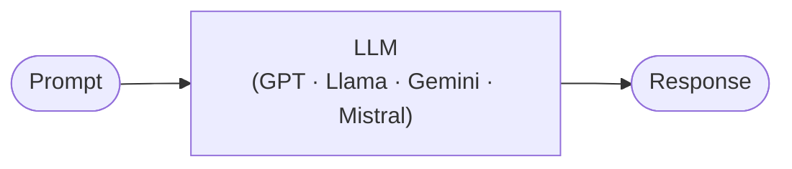
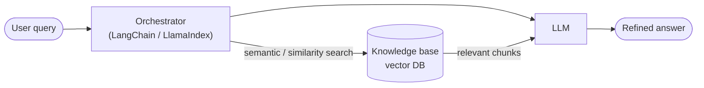
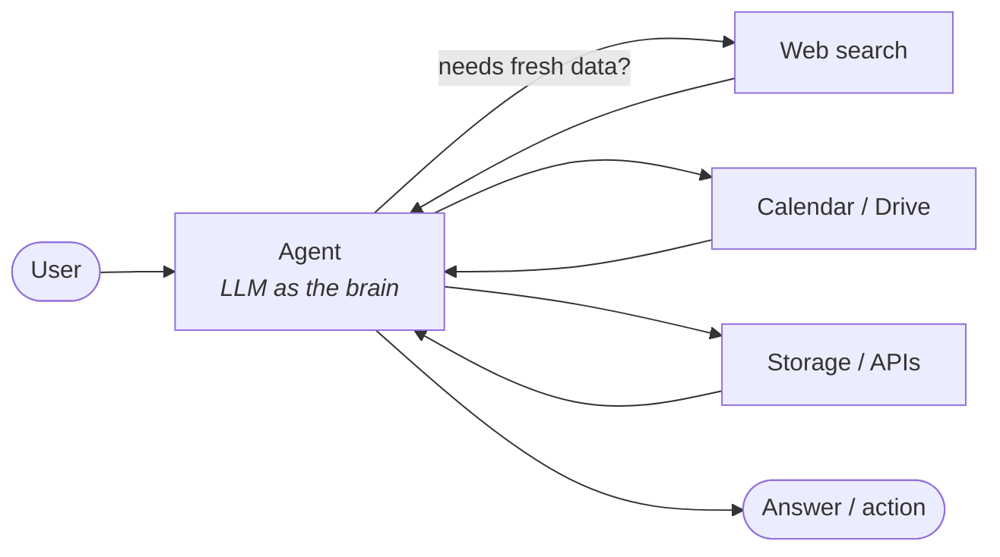

# 01 · Evolution from LLMs to Agentic AI

> **Video:** [00:08:33](https://www.youtube.com/watch?v=Zy7EXDONlTY&t=513s) · **Code:** none

## Definition

> [!IMPORTANT]
> **Agentic AI** is AI that takes a task or goal from a user and works toward completing it **on its own, with minimal human guidance**. It plans, takes actions, adapts to change, and **asks for help only when necessary**.

Examples you already use: ChatGPT with web search, Claude Desktop, Cursor, Antigravity. Given *"create a car-racing game in Python"*, they draft a **plan**, show it for review, execute it step by step, and pause to ask permission (`pip install …?`) before risky actions.

---

## Stage 1 · Plain LLM

Used for text generation, translation, summarization and chat. Later models added multimodal output (images).

**Limitation: knowledge cutoff.** A model only knows the data it was trained on. For example, GPT-4.1 lists a cutoff of *1 Jan 2024*, so anything after that date is unknown to it.

| Fix | Cost |
|---|---|
| **Fine-tune** on new data | Millions to billions of parameters: needs GPUs, budget and time. Fine for model vendors, unrealistic for an app developer |
| **RAG** (next stage) | Only the knowledge base changes and the model stays frozen |

---

## Stage 2 · RAG (Retrieval-Augmented Generation)

If the answer is inside the model's knowledge, the LLM replies directly. Otherwise it retrieves from the vector DB, then cleans up and rearranges the retrieved text into an answer. Updating knowledge means **adding documents, not retraining**.

**Limitation: real-time data.** Weather, stock prices and breaking news change by the minute, and nobody can keep re-ingesting them into a vector store.

---

## Stage 3 · Agent = LLM + tools + decision-making

What makes it an **agent** is that *the application decides* whether a tool is needed:

| Prompt to ChatGPT | Behaviour |
|---|---|
| "Tell me about Python" | Answers directly, no tool call (knowledge is before the cutoff) |
| "Latest news of the India election" | Calls the **web search tool**, reads several sources, then summarizes and cites them |

> [!NOTE]
> Modern agents go past single tool calls to **workflow automation**: plan, then execute, then test, then ask for human input. That is why companies use them for customer support, email handling and data collection that used to need manual staff.

---

## Summary

| | LLM | RAG | Agent |
|---|---|---|---|
| Knowledge | Frozen at cutoff | Cutoff + your documents | Cutoff + documents + live tools |
| Who decides the steps | Developer | Developer (fixed pipeline) | **The model** |
| Real-time data | ✗ | ✗ | ✓ |
| Takes actions | ✗ | ✗ | ✓ |

## References

[1] Model cards with context window, output tokens and knowledge cutoff. Available in [OpenAI models](https://platform.openai.com/docs/models)

[2] The original RAG paper. Available in [Lewis et al., 2020 — arXiv:2005.11401](https://arxiv.org/abs/2005.11401)
