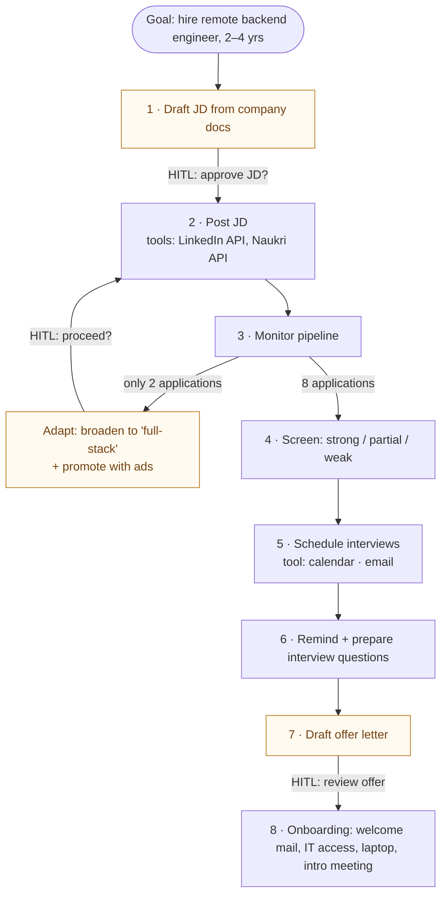
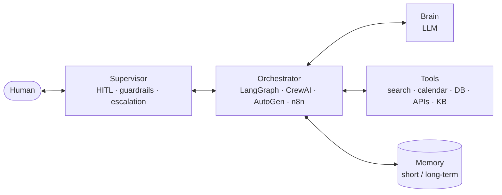

# 02 · Agentic AI: Core Characteristics & Components

> **Video:** [00:41:26](https://www.youtube.com/watch?v=Zy7EXDONlTY&t=2486s) · **Code:** none

## Worked example: an AI recruiter

**Prompt:** *"I want to hire a backend engineer with 2–4 years of experience."*
The agent already has access to the company's data (`DSwithBappy` platform docs, salary bands, requirements). It turns the prompt into a **goal** and proposes a plan, asking for confirmation at each risky step:



> [!NOTE]
> A **simple chatbot** only answers. It cannot pick tools, re-plan when results are poor, or pause for approval. Those abilities are what make this an *agent*.

---

## Six key characteristics

| Characteristic | Meaning | In the recruiter |
|---|---|---|
| **Autonomy** | Decides and acts toward the goal without step-by-step prompting | Posts, monitors and re-posts on its own |
| **Goal-oriented** | Holds a persistent objective, not isolated prompts | "Hire backend engineer" steers every step |
| **Planning** | Breaks a high-level goal into ordered sub-goals | JD → post → monitor → screen → interview → offer |
| **Reasoning** | The LLM interprets information, makes decisions, picks tools | Uses the LinkedIn API to post, *not* the calendar |
| **Adaptability** | Changes strategy on failure or feedback while staying on goal | Few applicants, so it rewrites the JD |
| **Context awareness** | Remembers the task, past interactions and preferences | "What's the progress?" two days later still works |

### Autonomy, and its guardrails

| Control | Purpose | Example |
|---|---|---|
| **Permission scopes** | Limit which tools / actions run unattended | May screen candidates, needs approval to *reject* |
| **Human-in-the-loop (HITL)** | Checkpoints that wait for a human | "Shall I post this JD?" |
| **Override controls** | Stop / pause / resume at any time | "Pause screening" |
| **Guardrails & policies** | Hard rules and ethical bounds (e.g. Guardrails AI) | "Never schedule interviews on weekends" |

> [!CAUTION]
> **Unchecked autonomy is dangerous.** It can send offers with the wrong salary, shortlist by age or nationality (breaking anti-discrimination law), or overspend on ads that are no longer needed.

### Goal-oriented: goals live in core memory

The goal acts as the **compass** for autonomy. It is persisted (framework-specific, but conceptually like this) so the agent can resume:

```json
{
  "goal": "Hire a backend engineer",
  "constraints": { "experience": "2-4 years", "remote": true, "stack": ["Python", "Django", "Cloud"] },
  "status": "active",
  "start_date": "2026-03-01",
  "progress": {
    "jd_created": true,
    "posted_on": ["LinkedIn", "AngelList"],
    "applications_received": 8,
    "interviews_scheduled": 2
  }
}
```

### Planning: generate, evaluate, select

1. **Generate candidate plans.** Plan A: post on LinkedIn / GitHub Jobs / AngelList. Plan B: internal referrals plus hiring agencies.
2. **Evaluate** on efficiency (which is faster), cost, risk (*what if nobody applies?*) and constraint alignment (remote only, budget).
3. **Select** with HITL, or with a pre-programmed policy such as *"prefer low-cost channels first"*.

### Reasoning: while planning *and* while executing

| During planning | During execution |
|---|---|
| Goal decomposition | Decision making (interview 2 of the 3 matches, reject 1) |
| Tool selection | HITL handling: knowing *when* to ask ("unsure about salary range") |
| Estimating time, dependencies, risk | Error handling: tool / API failure, then fall back to another tool |

> [!IMPORTANT]
> **Reasoning is the line between a chatbot and an agent.** The LLM decides for each input: *answer directly, or call a tool?*

### Context awareness = memory

| Memory | Holds |
|---|---|
| **Short-term** | State and metadata of the current run |
| **Long-term** | Whole conversation history, user preferences, past tool results |

---

## Five components



| Component | Role |
|---|---|
| **Brain (LLM)** | Goal interpretation, planning, reasoning, tool selection |
| **Orchestrator** | Agent framework: task sequencing, conditional routing, retry logic, loops, delegation. LangChain can build simple agents; **LangGraph** is the LangChain team's successor for agent workflows |
| **Tools** | Connect to external sources: web search, ArXiv, code interpreter, calendar / email / Zoom, browsers, databases, files, a RAG knowledge base |
| **Memory** | Conversation context and state tracking (short- and long-term) |
| **Supervisor** | Approval requests (HITL), guardrail enforcement, edge-case escalation (alert a human on uncertainty or conflict) |

> [!TIP]
> Quick test for whether an app is agentic: does it show **these characteristics** and contain **these components**?

## References

[1] Large catalog of ready-made tools and toolkits. Available in [LangChain integrations — tools](https://python.langchain.com/docs/integrations/tools/)

[2] Rule- and validator-based output guardrails. Available in [Guardrails AI](https://www.guardrailsai.com/)

[3] Workflow vs agent patterns. Available in [Anthropic — Building effective agents](https://www.anthropic.com/engineering/building-effective-agents)
