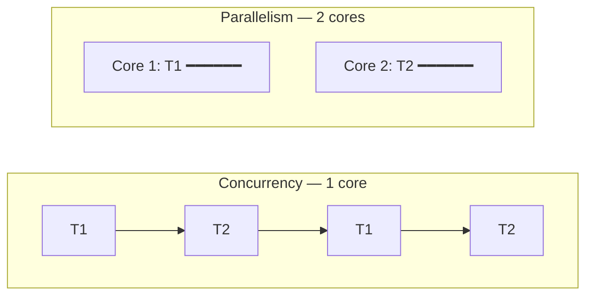

# 03 · Asynchronous Programming for AI Agents

> **Video:** [01:33:18](https://www.youtube.com/watch?v=Zy7EXDONlTY&t=5598s) · **Code:** [`src/01-async-programming/`](../../src/01-async-programming/) · **Slides:** [`docs/slides/03-asynchronous-programming.pdf`](../slides/03-asynchronous-programming.pdf)

## Why agents need it

Every orchestrator framework is **async at its core**, although each models orchestration differently:

| Framework | Orchestration model | Async |
|---|---|---|
| **LangGraph** | State machine (graph) | First-class |
| **AutoGen** | Actor model | Core |
| **CrewAI** | Role-based, process-driven | Supported |

A multi-agent system mostly does **I/O-bound** work: LLM calls, web search, scraping, DB queries. Run sequentially, the waits add up. Run concurrently, you wait roughly as long as the **slowest** agent.

```mermaid
gantt
    dateFormat s
    axisFormat %S s
    section Synchronous
    Agent 1 (1.0 min) :a1, 0, 60s
    Agent 2 (1.5 min) :a2, after a1, 90s
    Agent 3 (1.0 min) :a3, after a2, 60s
    section Asynchronous
    Agent 1 :b1, 0, 60s
    Agent 2 :b2, 0, 90s
    Agent 3 :b3, 0, 60s
```



> [!IMPORTANT]
> **Asynchronous programming** handles multiple tasks **concurrently without blocking** the program. It is meant for I/O-bound work (network requests, file I/O, DB queries): while one task waits on a slow external event, another runs.

**Analogy:** one burner and three dishes means cooking them one after another (T1 + T2 + T3). Three burners means all three finish in about max(T1, T2, T3).

---

## Subroutine vs coroutine

| | Subroutine (`def`) | Coroutine (`async def`) |
|---|---|---|
| Call behaviour | Caller **blocks** until it returns | Can **suspend** at `await`, handing control back to the event loop |
| While waiting on I/O | CPU idles | Event loop runs other coroutines |
| Sleep / wait | `time.sleep()` | `await asyncio.sleep()` |

> [!TIP]
> Step through the synchronous version on [Python Tutor](https://pythontutor.com) to *see* the interpreter wait inside each function before moving on. (`time` cannot be imported there, so drop the sleeps.)

---

## Code

**Synchronous:** about 6 s (4 + 2).

```python
import time

def fetch_weather():
    print("Fetching weather data...")
    time.sleep(4)            # simulate network delay
    print("Weather data fetched.")

def fetch_news():
    print("Fetching news data...")
    time.sleep(2)
    print("News data fetched.")

def main():
    start = time.time()
    fetch_weather()
    fetch_news()
    print(f"Total time taken: {time.time() - start} seconds")

main()
```

**Asynchronous:** about 4 s, which is max(4, 2).

```python
import asyncio, time

async def fetch_weather():
    print("Fetching weather data...")
    await asyncio.sleep(4)   # NOT time.sleep — that would block the loop
    print("Weather data fetched.")

async def fetch_news():
    print("Fetching news data...")
    await asyncio.sleep(2)
    print("News data fetched.")

async def main():
    start = time.time()
    await asyncio.gather(fetch_weather(), fetch_news())
    print(f"Total time taken: {time.time() - start} seconds")

await main()                 # top-level await works in Jupyter; use asyncio.run(main()) in a .py file
```

> [!WARNING]
> Calling `time.sleep()` (or any blocking client) inside an `async def` **freezes the whole event loop**, which removes the benefit. Use async-native calls such as `asyncio.sleep`, `httpx.AsyncClient` and `llm.ainvoke`.

---

## Concurrency vs parallelism

| | Concurrency | Parallelism |
|---|---|---|
| Definition | Managing multiple tasks whose lifetimes **overlap** | Running tasks **simultaneously** on multiple threads / processes |
| Hardware | Can be a single core (context switching) | Multiple cores |
| Python tool | `asyncio` | `multiprocessing`, `concurrent.futures` |
| Best for | I/O-bound | CPU-bound |



> [!NOTE]
> You rarely write `asyncio` by hand when using LangGraph / AutoGen / CrewAI, because the framework does it. The syntax (`async def`, `await`, `ainvoke`, `astream`) still shows up everywhere, so it has to be readable.

## References

[1] Event loop, tasks, `gather`. Available in [Python docs — asyncio](https://docs.python.org/3/library/asyncio.html)

[2] Async invocation and streaming of graphs. Available in [LangGraph docs](https://langchain-ai.github.io/langgraph/)
