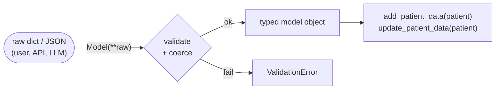

# 04 · Pydantic for AI Agents — Data Validation

> **Video:** [02:06:23](https://www.youtube.com/watch?v=Zy7EXDONlTY&t=7583s) · **Code:** [`src/02-pydantic/pydantic_for_agents.ipynb`](../../src/02-pydantic/pydantic_for_agents.ipynb)

## Why Pydantic

> [!IMPORTANT]
> **Pydantic** is the most widely used data-validation and settings library for Python. It uses **type hints** to define schemas, then validates, parses and coerces data at runtime. Its core is written in **Rust**.

In agents, LLMs produce **unstructured** text. Pydantic schemas are how you get **structured, typed output** (`llm.with_structured_output(Model)`), define **tool argument schemas**, and type the **graph state**.

| Feature | What it gives you |
|---|---|
| Validation & parsing | Rules declared once on the model, enforced everywhere |
| Type-hint integration | Schema = annotated class, no hand-written `if type(x) == …` |
| Fast | Rust core |
| Strict / lax modes | Lax coerces `"25"` → `25`; strict rejects it |
| Clear errors | `ValidationError` names the field and the reason |
| JSON Schema | `Model.model_json_schema()` for docs, tool specs, other languages |

> [!TIP]
> Use **Pydantic v2** (`>=2.0`). v1 is legacy and the API differs (`.dict()` vs `.model_dump()`). `EmailStr` additionally needs `pip install "pydantic[email]"`.

---

## The problem without it

Python is dynamically typed, so `add_patient_data("Bappy", "25")` happily stores age as a **string**. A later `WHERE age > 25` silently skips that patient. Guarding by hand looks like this:

```python
def add_patient_data(name: str, age: int):
    if type(name) == str and type(age) == int:
        if age >= 0:
            ...  # insert
        else:
            raise ValueError("Age cannot be negative.")
    else:
        raise TypeError("Name should be str and age should be int.")
```

…and it has to be **copied into every function** (`update_patient_data`, …) and extended for every new rule. That does not scale.

## The 3-step Pydantic pattern



```python
from pydantic import BaseModel

class PatientData(BaseModel):          # 1 · schema
    name: str
    age: int
    weight: float

def add_patient_data(patient: PatientData):
    print(patient.name, patient.age, patient.weight)

raw = {"name": "Bappy", "age": "25", "weight": "70.5"}
patient = PatientData(**raw)           # 2 · validate (lax mode coerces "25" → 25)
add_patient_data(patient)              # 3 · pass the validated object
```

`"age": "seventy"` → `ValidationError: Input should be a valid integer`.

---

## Feature tour

| Topic | Syntax | Notes |
|---|---|---|
| Collections | `allergies: List[str]`, `contact_info: Dict[str, str]` | From `typing`; inner types are validated too |
| Optional / default | `allergies: Optional[List[str]] = None`, `married: bool = False` | Without a default, the field is **required** |
| Built-in validators | `email: EmailStr`, `linkedin_url: AnyUrl` | `"bappygmail.com"` → *not a valid email* |
| Constraints | `name: str = Field(max_length=50)`, `age: int = Field(gt=0, lt=100)`, `Field(max_length=5)` on lists | |
| Metadata | `Annotated[str, Field(title=..., description=..., examples=[...])]` | The description doubles as **LLM guidance** in structured output |
| Strict mode | `Annotated[float, Field(strict=True)]` | `"70.5"` is now rejected |
| Field validator | `@field_validator("email")` + `@classmethod` | Custom single-field rules **and transforms** |
| Model validator | `@model_validator(mode="after")` | Rules across **several fields** |
| Computed field | `@computed_field` + `@property` | Derived values (BMI) included in dumps |
| Nested models | `address: Address` | Access with `patient.address.city` |
| Serialization | `.model_dump()` → `dict`, `.model_dump_json()` → `str` | Save / send / reload |

### Field validator: domain check and transform

Only HDFC / ICICI employees get the partner-bank discount, so the email domain is validated. Names are also normalised to upper case.

```python
from pydantic import BaseModel, EmailStr, field_validator

class PatientData(BaseModel):
    name: str
    email: EmailStr

    @field_validator("email")
    @classmethod
    def email_validator(cls, value):
        if value.split("@")[-1] not in ["hdfc.com", "icici.com"]:
            raise ValueError("Not a valid domain")
        return value

    @field_validator("name")
    @classmethod
    def transform_name(cls, value):
        return value.upper()
```

### Model validator: cross-field rule

```python
from pydantic import model_validator

class PatientData(BaseModel):
    age: int
    contact_details: dict[str, str]

    @model_validator(mode="after")
    def validate_emergency_contact(cls, model):
        if model.age > 60 and "emergency" not in model.contact_details:
            raise ValueError("Patients older than 60 must have an emergency contact")
        return model
```

### Computed field

```python
from pydantic import computed_field

class PatientData(BaseModel):
    weight: float   # kg
    height: float   # m

    @computed_field
    @property
    def bmi(self) -> float:
        return round(self.weight / self.height**2, 2)
```

### Nested model and serialization

```python
class Address(BaseModel):
    city: str
    state: str
    pin: str

class PatientData(BaseModel):
    name: str
    gender: str
    age: int
    address: Address

p = PatientData(name="Kishor", gender="male", age=40,
                address=Address(city="gurgaon", state="haryana", pin="122001"))
p.address.city          # 'gurgaon'
p.model_dump()          # dict
p.model_dump_json()     # JSON string
```

> [!NOTE]
> Where this shows up later: **structured output** (writer / critic agents in [06](06-langchain-multi-agent.md)), **graph state schemas** ([08](08-langgraph-core-components.md)), **routing decisions** such as sentiment and grading ([11](11-conditional-workflows.md)), and **tool input schemas** ([19](19-tool-integration.md)).

## References

[1] Models, fields, validators, serialization. Available in [Pydantic v2 docs](https://docs.pydantic.dev/latest/)

[2] `with_structured_output` with Pydantic models. Available in [LangChain — structured output](https://python.langchain.com/docs/concepts/structured_outputs/)
