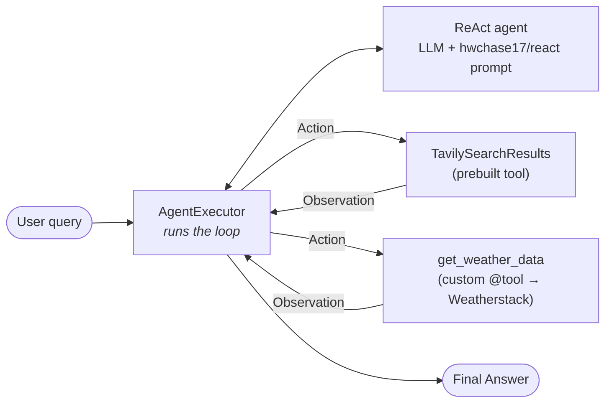
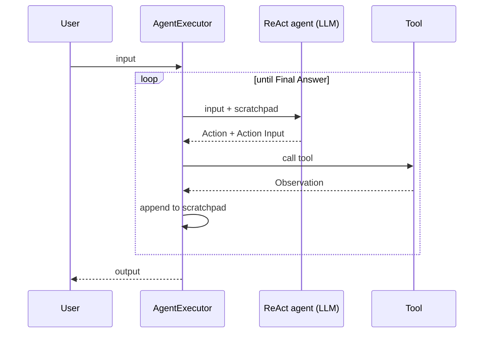

# 05 · Building an End-to-End Single AI Agent with LangChain

> **Video:** [03:27:08](https://www.youtube.com/watch?v=Zy7EXDONlTY&t=12428s) · **Code:** [`src/03-langchain-single-agent/`](../../src/03-langchain-single-agent/)

## Project overview

A **search + weather agent**: one ReAct agent, one LLM (`gpt-3.5-turbo`, cutoff 2022), two tools. It answers multi-step questions such as *"Find the capital of India **and then** its current weather"*, which the bare model cannot answer.



> [!NOTE]
> This uses the **legacy LangChain 0.1 agent API** (`create_react_agent` + `AgentExecutor`), pinned in [`requirements.txt`](../../src/03-langchain-single-agent/requirements.txt). It is taught to show how agents were built *before* LangGraph. Its limitations are the motivation for [07](07-langchain-vs-langgraph.md).

---

## Lesson 01 · Setup

```bash
conda create -n langagent python=3.11 -y
conda activate langagent
pip install -r requirements.txt     # langchain, langchain-community, langchain-core, langchain-openai,
                                    # requests, tavily-python, python-dotenv, langchainhub, streamlit
cp .env.example .env                # OPENAI_API_KEY, TAVILY_API_KEY, WEATHERSTACK_API_KEY
```

| Key | Where | Free tier |
|---|---|---|
| `OPENAI_API_KEY` | platform.openai.com → API keys | Paid; any provider works (Groq, Gemini, OpenRouter) by swapping the chat class |
| `TAVILY_API_KEY` | tavily.com dashboard | 1,000 credits |
| `WEATHERSTACK_API_KEY` | weatherstack.com dashboard | Current weather only |

> [!TIP]
> **Windows SSL path errors:** set `os.environ["SSL_CERT_FILE"] = certifi.where()` *before* `load_dotenv()` so requests use the up-to-date CA bundle.

## Lesson 02 · Tools and LLM

```python
from langchain_community.tools.tavily_search import TavilySearchResults
from langchain_openai import ChatOpenAI

search_tool = TavilySearchResults(max_results=2)          # 2 reference sites per search
search_tool.invoke("Give me the latest news on AI")      # live results

llm = ChatOpenAI(model="gpt-3.5-turbo", temperature=0)
llm.invoke("What year is it?")                           # → "2022": knowledge cutoff
```

**Custom tool:** any function becomes a tool with `@tool`. The **docstring is what the LLM reads** when deciding whether to call it.

```python
from langchain.tools import tool
import requests

@tool
def get_weather_data(city: str) -> str:
    """Fetch current weather information for a city."""
    url = f"https://api.weatherstack.com/current?access_key={WEATHERSTACK_API_KEY}&query={city}"
    data = requests.get(url).json()
    if "current" not in data:
        return f"Could not fetch weather data for {city}"
    return (f"City: {city}\nTemperature: {data['current']['temperature']}°C\n"
            f"Weather: {data['current']['weather_descriptions'][0]}\n"
            f"Humidity: {data['current']['humidity']}%")
```

## Lesson 03 · Agent and executor

```python
from langchain import hub
from langchain.agents import create_react_agent, AgentExecutor

prompt = hub.pull("hwchase17/react")                     # community ReAct prompt from LangChain Hub
tools  = [search_tool, get_weather_data]

agent          = create_react_agent(llm=llm, tools=tools, prompt=prompt)
agent_executor = AgentExecutor(agent=agent, tools=tools, verbose=True, handle_parsing_errors=True)

agent_executor.invoke({"input": "Find the capital of India and then find its current weather."})["output"]
```

| Experiment | Result |
|---|---|
| `"Find the capital of India"` | Calls Tavily, returns **New Delhi** |
| `"Latest news on Iran–USA"` | Calls Tavily and gives a 2026 answer from a 2022 model |
| Same, with `tools = []` | Loops looking for a tool, then *"Agent stopped due to iteration limit or time limit"* |
| Capital + weather | Tavily (capital), then `get_weather_data` (37 °C, haze) |
| `verbose=False` | Same output, no Thought / Action log |

---

## How ReAct works: **Re**asoning + **Act**ing

> [!IMPORTANT]
> Instead of answering in one go, the model **thinks step by step**: *Thought* (what to do next), *Action* (which tool, with what input), *Observation* (the tool result), and repeats until *"I now know the final answer"*.

The `hwchase17/react` prompt hard-codes this format:

```text
Answer the following questions as best you can. You have access to the following tools:
{tools}

Question: the input question you must answer
Thought: you should always think about what to do
Action: the action to take, should be one of [{tool_names}]
Action Input: the input to the action
Observation: the result of the action
... (this Thought/Action/Action Input/Observation can repeat N times)
Thought: I now know the final answer
Final Answer: the final answer to the original input question

Question: {input}
Thought:{agent_scratchpad}
```

`agent_scratchpad` holds the accumulated *Thought / Action / Observation* history, so each loop sees what already happened.

**Example:** *"Capital of France and its population?"*

| Loop | Thought | Action | Observation |
|---|---|---|---|
| 1 | I need the capital of France | `search("capital of France")` | Paris |
| 2 | Now I need the population of Paris | `search("population of Paris")` | ~2.1 M |
| 3 | I now know the final answer | — | **Final Answer:** Paris, ~2.1 M |

## Why `AgentExecutor`

`create_react_agent` only returns a *decision-maker* (given the input and scratchpad, it outputs the next action). **`AgentExecutor` is the runtime loop** that:

1. Sends the input and previous steps to the agent (empty on the first pass).
2. Gets the next action.
3. **Executes the tool** with the given input.
4. Appends the observation to the history.
5. Repeats until the agent returns `Final Answer`, or the iteration / time limit is hit.



---

## Lesson 04 · From notebook to app

| File | Purpose |
|---|---|
| [`research/agent_demo.ipynb`](../../src/03-langchain-single-agent/research/agent_demo.ipynb) | Step-by-step experiments |
| [`main.py`](../../src/03-langchain-single-agent/main.py) | Same code as a script: `python main.py` |
| [`app.py`](../../src/03-langchain-single-agent/app.py) | Streamlit UI (text input + *Run Agent* button): `streamlit run app.py` |

## Lesson 05 · Deploy on Render (free)

1. Add `.gitignore` (`.env`, `research/`), push to a GitHub repo.
2. Render, then **New Web Service**, then the public Git repository URL.
3. Build: `pip install -r requirements.txt`. Start: `streamlit run app.py --server.port $PORT --server.address 0.0.0.0`.
4. Free instance (512 MB RAM / 0.1 CPU). Add the three API keys as **environment variables**, then deploy.

> [!WARNING]
> Never push `.env`. Rotate any key that was ever shown on screen or committed.

## References

[1] Prompt used by `create_react_agent`. Available in [LangChain Hub — hwchase17/react](https://smith.langchain.com/hub/hwchase17/react)

[2] The ReAct paper. Available in [Yao et al., 2022 — arXiv:2210.03629](https://arxiv.org/abs/2210.03629)

[3] Search API for agents. Available in [Tavily](https://tavily.com)

[4] Free-tier web service hosting. Available in [Render docs](https://render.com/docs/web-services)
