# 06 · Building an End-to-End Multi-Agent AI System with LangChain

> **Video:** [04:49:37](https://www.youtube.com/watch?v=Zy7EXDONlTY&t=17377s) · **Code:** [`src/04-langchain-multi-agent/`](../../src/04-langchain-multi-agent/) · **Diagram:** [`06-multi-agent-research-system.excalidraw`](../diagrams/06-multi-agent-research-system.excalidraw)

## Project overview

A **multi-agent research assistant**: give it a topic and it *thinks, searches, reads and writes* on its own. Instead of one agent with many tools, a **team of specialists** shares a state memory and produces a professional report with a reviewer's score.

```mermaid
flowchart LR
    T(["Research topic"]) --> S["① Search agent<br/>tool: web_search (Tavily)"]
    S -->|"titles · URLs · snippets"| M1[("state['search_results']")]
    M1 --> R["② Reader agent<br/>tool: scrape_url (trafilatura / readability / BS4)"]
    R -->|"clean page text"| M2[("state['scraped_content']")]
    M1 & M2 --> W["③ Writer chain<br/>prompt | llm | parser"]
    W -->|"draft"| M3[("state['report']")]
    M3 --> C["④ Critic chain<br/>prompt | llm | parser"]
    C --> M4[("state['feedback']<br/>Score X/10 · strengths · improvements · verdict")]

    classDef agent fill:#e6f0ff,stroke:#2b6cb0,color:#1a365d;
    classDef chain fill:#e6fffa,stroke:#2c7a7b,color:#234e52;
    classDef mem fill:#fffaf0,stroke:#b7791f,color:#744210;
    class S,R agent;
    class W,C chain;
    class M1,M2,M3,M4 mem;
```



## Why multi-agent

Think of a company team. A **single full-stack generalist** can ship the whole project, but the deep parts come out average. **Specialists** (front-end, AI, back-end), each researching only their own area, produce better work that is then combined.

> [!IMPORTANT]
> Single agent + many tools + many responsibilities = **poorer output**. Split the job, give each agent **one task and only the tools it needs**, and pass results through shared state. Claude Desktop, Antigravity and VS Code agents run many sub-agents behind the scenes for the same reason.

---

## Lesson 01 · Setup and modular structure

```bash
conda create -n langagent python=3.11 -y && conda activate langagent
pip install -r requirements.txt   # langchain (modern), langchain-openai, tavily-python, beautifulsoup4,
                                  # readability-lxml, trafilatura, lxml, streamlit, python-dotenv, rich
cp .env.example .env              # OPENAI_API_KEY, TAVILY_API_KEY
```

```text
04-langchain-multi-agent/
├── app.py                 # Streamlit UI
├── main.py                # CLI test entry point
└── src/
    ├── tools/tools.py     # web_search, scrape_url
    ├── agents/agents.py   # search agent, reader agent, writer chain, critic chain
    └── pipelines/pipeline.py  # run_research_pipeline(topic) → state dict
```

> [!TIP]
> Build bottom-up: **env → tools → agents → pipeline → test (`main.py`) → UI (`app.py`) → deploy**, committing after each step.

## Lesson 02 · Tools

```python
from tavily import TavilyClient
from langchain.tools import tool

tavily = TavilyClient(api_key=os.getenv("TAVILY_API_KEY"))

@tool
def web_search(query: str) -> str:
    """Search the web for recent and reliable information on a topic. Returns Titles, URLs and snippets."""
    results = tavily.search(query=query, max_results=5)
    return "\n----\n".join(
        f"Title: {r['title']}\nURL: {r['url']}\nSnippet: {r['content'][:300]}\n"
        for r in results["results"]
    )
```

Here Tavily is wrapped **as a custom tool** around `TavilyClient`, rather than LangChain's prebuilt `TavilySearchResults` used in [05](05-langchain-single-agent.md). The output is trimmed to title / URL / 300-char snippet so the next agent gets only what it needs.

`scrape_url(url)` uses **three fallback strategies**, each capped at 5,000 characters:

| Order | Strategy | Good for |
|---|---|---|
| 1 | `trafilatura.extract(html)` | Articles and blogs |
| 2 | `readability.Document(html).summary()` → BeautifulSoup | Main content block |
| 3 | Full-page BeautifulSoup, stripping `script / style / nav / footer / header / aside / form` | Last resort |

Timeouts and HTTP errors are **returned as strings**, not raised, so the agent can read the failure and move on.

> [!TIP]
> `from rich import print` makes nested tool output readable while debugging. Once decorated with `@tool`, call tools with `.invoke(...)` rather than as plain functions.

## Lesson 03 · Agents (modern API) and LCEL chains

**`create_react_agent` + `AgentExecutor` (legacy) → `create_agent` (modern).** The Thought / Action / Observation loop is now built in, so no executor is needed.

| | `create_react_agent` (LangChain 0.1) | `create_agent` (LangChain 1.x) |
|---|---|---|
| Loop runner | Separate `AgentExecutor` | Built in |
| Prompt | You pass the ReAct prompt (`hub.pull`) | Default system prompt; optional `system_prompt=` |
| Input | `{"input": "..."}` | `{"messages": [("user", "...")]}` |
| Output | `result["output"]` | `result["messages"][-1].content` |
| Status | Deprecated | Recommended |

```python
from langchain.agents import create_agent
llm = ChatOpenAI(model="gpt-4o-mini", temperature=0)

def build_search_agent():
    return create_agent(model=llm, tools=[web_search])

def build_reader_agent():
    return create_agent(model=llm, tools=[scrape_url])
```

The writer and critic **need no tools**, since all the input is already in state. A plain **LCEL chain** (`prompt | llm | parser`) is enough:

```python
writer_chain = writer_prompt | llm | StrOutputParser()   # {topic, research} → Intro · ≥3 Key Findings · Conclusion · Sources
critic_chain = critic_prompt | llm | StrOutputParser()   # {report} → "Score: X/10 / Strengths / Areas to Improve / One line verdict"
```

> [!NOTE]
> Rule of thumb: use an **agent** when the step must *decide* which tool to call; use a **chain** when the step is a fixed transformation.

## Lesson 04 · Pipeline: shared state memory

```python
def run_research_pipeline(topic: str) -> dict:
    state = {}

    search = build_search_agent().invoke(
        {"messages": [("user", f"Find recent, reliable and detailed information about: {topic}")]})
    state["search_results"] = search["messages"][-1].content

    reader = build_reader_agent().invoke({"messages": [("user",
        f"Based on the following search results about '{topic}', pick the most relevant URL "
        f"and scrape it for deeper content.\n\nSearch Results:\n{state['search_results'][:800]}")]})
    state["scraped_content"] = reader["messages"][-1].content

    state["report"] = writer_chain.invoke({
        "topic": topic,
        "research": f"SEARCH RESULTS:\n{state['search_results']}\n\n"
                    f"DETAILED SCRAPED CONTENT:\n{state['scraped_content']}",
    })
    state["feedback"] = critic_chain.invoke({"report": state["report"]})
    return state
```

> [!IMPORTANT]
> `state` is a plain **in-memory dict**, cleared when the run ends. The URLs are passed to the writer *along with* the scraped text so it can cite **Sources**. Persistent memory comes later with LangGraph checkpointers ([14](14-persistence.md), [17](17-database-persistence.md)).

## Lesson 05 · UI and deploy

* `python main.py`: terminal run on *"The impact of AI on the job market in 2026"*. The critic gave the draft **6/10**.
* `streamlit run app.py`: a ChatGPT-generated dark UI showing a 4-stage pipeline status, expanders for each stage's output, a **download `.md`** button and critic feedback.
* README generated by an IDE agent from the codebase, then edited by hand.
* **Render:** New Web Service from the public repo. Start command `streamlit run app.py --server.port $PORT --server.address 0.0.0.0`, free 512 MB instance, set `OPENAI_API_KEY` and `TAVILY_API_KEY`. Delete the service from *Settings → Delete web service* when done.

> [!TIP]
> To raise the critic score, edit the **writer prompt** (more sections, more depth). The critic's *Areas to Improve* list is effectively a prompt-engineering to-do list.

## References

[1] Modern agent constructor. Available in [LangChain — `create_agent`](https://python.langchain.com/docs/concepts/agents/)

[2] LCEL `prompt | llm | parser` composition. Available in [LangChain Expression Language](https://python.langchain.com/docs/concepts/lcel/)

[3] Article text extraction. Available in [trafilatura docs](https://trafilatura.readthedocs.io/)

[4] Search API used by the search agent. Available in [Tavily Python SDK](https://docs.tavily.com/)
