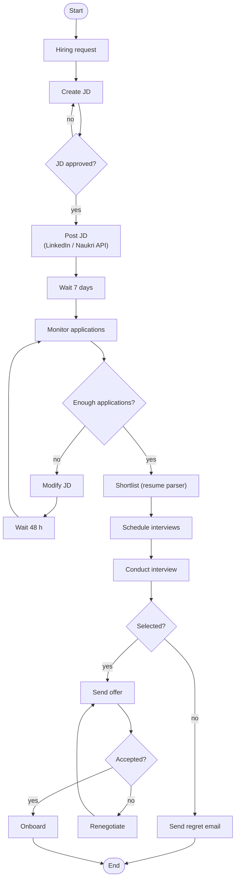

# 07 · What is LangGraph & Why It's Required? — LangChain vs LangGraph

> **Video:** [06:30:27](https://www.youtube.com/watch?v=Zy7EXDONlTY&t=23427s) · **Code:** none (concept session) · **Diagram:** [`07-langchain-vs-langgraph.excalidraw`](../diagrams/07-langchain-vs-langgraph.excalidraw)

## LangChain in one paragraph

> [!NOTE]
> **LangChain** is an open-source library of modular building blocks for LLM apps: **models** (one interface to OpenAI, Anthropic, Llama, Mistral…), **prompts** (templates and prompt engineering), **retrievers** (fetch chunks from a vector store), loaders and tools. Its signature feature is the **chain**, a *sequential* pipeline where each block's output is the next block's input (`prompt | llm | parser`). It is well suited to chatbots, summarization, translation, multi-step linear flows, RAG and basic tool-using agents.

---

## Workflow vs agent

| | Workflow | Agent |
|---|---|---|
| Definition (Anthropic) | LLMs and tools orchestrated through **predefined code paths** | LLMs **dynamically direct** their own process and tool usage |
| Control | Developer | Model |

The AI-recruiter example ([02](02-agentic-ai-characteristics-and-components.md)) redrawn as a **workflow**:



---

## Seven reasons LangChain struggles with this

| # | Challenge | In LangChain | In LangGraph |
|---|---|---|---|
| 1 | **Conditional branches, loops, jumps** | Chains are linear. Needs hand-written `while` / `if` **glue code** | Nodes + edges + `add_conditional_edges`, cycles allowed |
| 2 | **State handling** | **Stateless.** Memory stores *conversation* only, not key-value workflow data | **Stateful.** A typed `State` (TypedDict / Pydantic) is passed to and updated by every node |
| 3 | **Event-driven execution** | Sequential start → finish, with no pause / wait-for-trigger | Can pause and resume on triggers ("wait 7 days") |
| 4 | **Fault tolerance** | Failure mid-chain means **rerun from the start** | State is checkpointed, so retry / resume from the failed node, even after a server crash |
| 5 | **Human-in-the-loop** | `input()` blocks the chain and wastes compute | First-class: interrupt, wait (even days), resume |
| 6 | **Nested workflows** | No sub-chains as nodes | **Subgraphs**: a node can itself be a graph (e.g. *conduct interview* with rounds 1-2-3) |
| 7 | **Observability** | LangSmith traces chains, but **not your glue code** | Every node execution is traced in LangSmith |

### Glue code vs graph

**LangChain:** the loop lives *outside* the framework.

```python
jd_chain = jd_prompt | llm | StrOutputParser()

approved, jd = False, None
while not approved:                       # glue code ↓
    jd = jd_chain.invoke({"request": request})
    approved = approve_jd(jd) == "approved"
post_jd(jd)
```

**LangGraph:** the loop is *declared* as a conditional edge.

```python
graph.add_node("hiring_request", hiring_request)
graph.add_node("create_jd", create_jd)
graph.add_node("check_approval", check_approval)
graph.add_node("post_jd", post_jd)

graph.add_edge("hiring_request", "create_jd")
graph.add_edge("create_jd", "check_approval")
graph.add_conditional_edges("check_approval", route,
                            {"approved": "post_jd", "rejected": "create_jd"})   # loop back
```

### State is the shared memory

```python
class HiringState(TypedDict):
    goal: str
    jd_text: str
    jd_approved: bool
    jd_posted: bool
    num_applications: int
    shortlisted: list[str]
    offer_sent: bool
    interview_questions: list[str]
```

Each node reads state, does its work and **returns a partial update**. The graph merges it, and the next node decides (e.g. `num_applications < 20` → *modify JD*) **from state**.

> [!TIP]
> Fault tolerance and HITL fall out of state: LangGraph **snapshots state after every node** (checkpointer), so it can retry the failed node, survive a crash, or wait days for a human without holding compute.

---

## LangGraph defined

> [!IMPORTANT]
> **LangGraph** is an orchestration framework for **stateful, multi-step, event-driven** LLM workflows, for single agents and multi-agent systems alike. Think of it as a **flowchart engine for LLMs**: you define steps (**nodes**), connections (**edges**) and transition logic, and it handles **state, branching, looping, pausing / resuming and fault recovery**.

## When to use which

| Use **LangChain** | Use **LangGraph** |
|---|---|
| Simple linear flows: prompt chaining, summarization, basic RAG, chatbots | Non-linear workflows with conditions and loops |
| | Human-in-the-loop, multi-agent coordination |
| | Async / event-driven, long-running, resumable |

> [!NOTE]
> **"Is LangChain deprecated?" No.** LangGraph is **built on LangChain**. You still load models (`ChatOpenAI`), prompts (`ChatPromptTemplate`), retrievers, loaders and tools from LangChain. **LangChain provides the bricks; LangGraph does the orchestration.**

## References

[1] Workflow vs agent patterns (prompt chaining, routing, parallelization, orchestrator-workers, evaluator-optimizer). Available in [Anthropic — Building effective agents](https://www.anthropic.com/engineering/building-effective-agents)

[2] Concepts, HITL, subgraphs, persistence. Available in [LangGraph docs](https://langchain-ai.github.io/langgraph/)

[3] Tracing and evaluation. Available in [LangSmith](https://docs.smith.langchain.com/)
