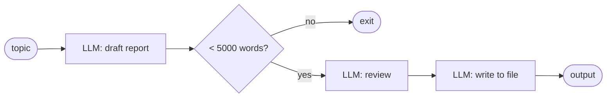
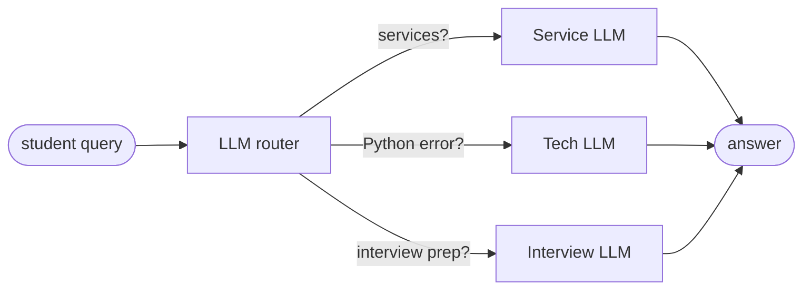
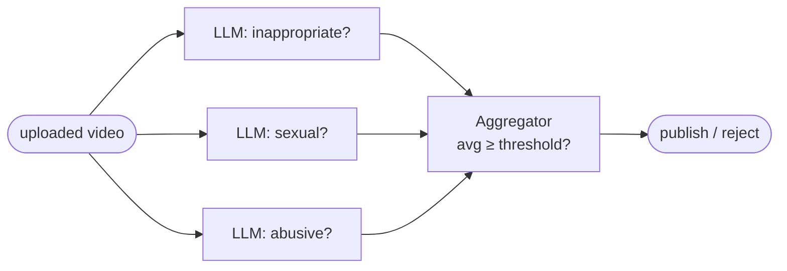
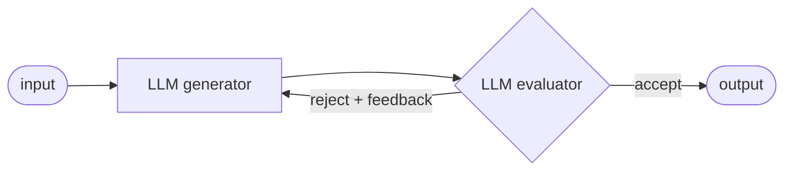
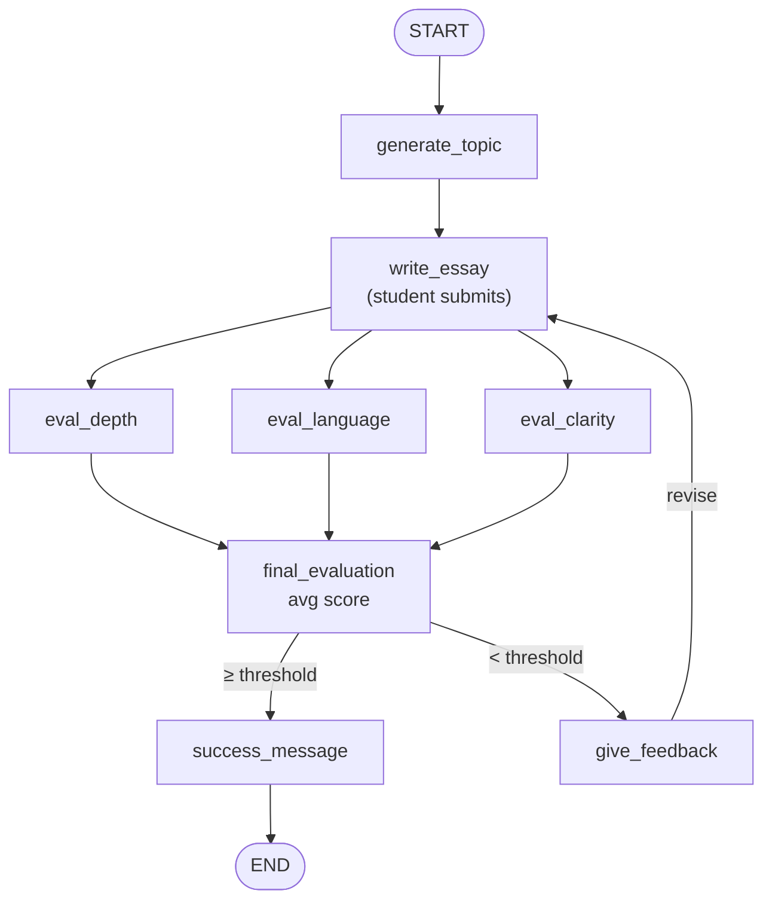
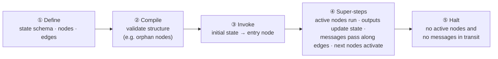

# 08 · Understanding LangGraph Core Components

> **Video:** [07:44:43](https://www.youtube.com/watch?v=Zy7EXDONlTY&t=27883s) · **Code:** concept session; applied from [09](09-sequential-workflows.md) on in [`src/05-langgraph-workflows/`](../../src/05-langgraph-workflows/) · **Diagram:** [`08-12-langgraph-workflows.excalidraw`](../diagrams/08-12-langgraph-workflows.excalidraw)

> [!IMPORTANT]
> **LangGraph** is an orchestration framework for **intelligent, stateful, multi-step LLM workflows**. It models your logic as a **graph of nodes (tasks) and edges (routing)** rather than a linear chain, which enables **parallelism, loops, branching, memory and resumability**.

| Capability | Meaning |
|---|---|
| Parallelism | Independent nodes run at the same time |
| Loops | An edge can go *back* to an earlier node |
| Branching | Conditional edges pick the next node at runtime |
| Memory | Every node's input / output lives in shared state |
| Resumability | After a crash, continue from the failing node rather than the start |

---

## LLM workflows: five common patterns

An **LLM workflow** is a step-by-step process where each step does a distinct task (prompting, reasoning, tool calling, memory access, decision). If there is no LLM call, it is not an LLM workflow.

### 1 · Prompt chaining (sequential)



### 2 · Routing



### 3 · Parallelization

Independent checks run concurrently, then get aggregated (example: YouTube upload moderation).



### 4 · Orchestrator–workers

Looks like parallelization, but **an orchestrator LLM decides at runtime** which workers (one, some or all) get which sub-task, and a synthesizer merges the results.

### 5 · Evaluator–optimizer



Example: generate a JD, then have it critiqued and regenerated until it is accepted.

---

## Graph, nodes, edges: the UPSC essay evaluator

**Problem:** generate a UPSC-style essay topic, collect the student's essay, evaluate it **in parallel** on *depth of analysis*, *language quality* and *clarity of thought*, aggregate the scores, then either congratulate or give feedback (and allow resubmission).



| Term | Is | Here |
|---|---|---|
| **Graph** | The whole workflow | The diagram above |
| **Node** | One task, written as a **plain Python function** | `generate_topic`, `eval_depth`, … |
| **Edge** | Which node runs after which (routing) | `write_essay → eval_*` fan-out, conditional exit |

> [!TIP]
> Recipe: **goal → break into tasks → each task becomes a node → connect with edges.**

---

## State: the shared memory

```python
from typing import TypedDict

class EssayState(TypedDict):
    topic: str
    essay_text: str
    depth_score: float
    language_score: float
    clarity_score: float
    total_score: float
    feedback: str
    evaluation_round: int
```

* Defined up front with a **`TypedDict`** or a **Pydantic** model (see [04](04-pydantic-data-validation.md)).
* **Every node receives the state and returns a partial update.** State is shared and **mutable**, and saved after each step.

## Reducers: *how* updates are applied

> [!IMPORTANT]
> A **reducer** defines how a node's update is applied to a state key: **replace** (the default), **add / append**, or **merge**.

| Scenario | Reducer | Why |
|---|---|---|
| `a=5, b=6 → sum=11 → ×3 = 33` | Replace | Only the latest value matters |
| Chatbot: "Hi, I'm Bappy" → "I like football" → "What's my name?" | **Append** messages | With replace, the name is gone |
| Essay feedback across rounds | **Append** | The evaluator should see earlier feedback and not repeat itself |

```python
from typing import Annotated
import operator
from langgraph.graph.message import add_messages

class EssayState(TypedDict):
    feedback: Annotated[list[str], operator.add]     # append
    messages: Annotated[list, add_messages]           # append + dedupe by id (chat)
```

---

## Execution model: Google Pregel

LangGraph executes graphs with the **Pregel** model (Google's system for large-scale graph processing) in **super-steps**:



> [!NOTE]
> Nodes that become active in the **same super-step run in parallel**. This is how the three `eval_*` nodes execute together, and why parallel branches need reducers when they write the same key.

## References

[1] The five workflow patterns. Available in [Anthropic — Building effective agents](https://www.anthropic.com/engineering/building-effective-agents)

[2] State, reducers, super-steps. Available in [LangGraph — Graph API concepts](https://langchain-ai.github.io/langgraph/concepts/low_level/)

[3] Pregel. Available in [Malewicz et al., 2010 — Pregel: a system for large-scale graph processing](https://research.google/pubs/pregel-a-system-for-large-scale-graph-processing/)
