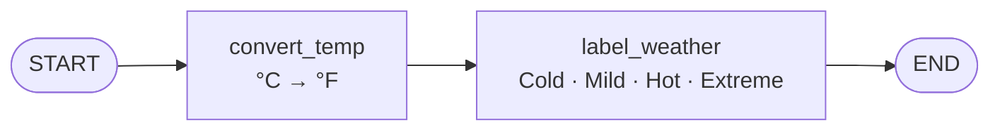
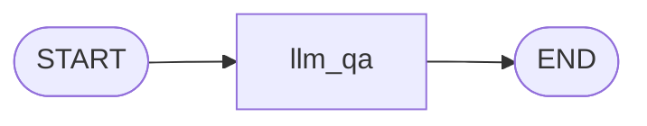
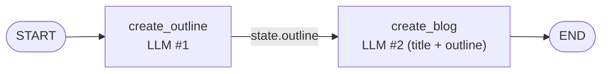

# 09 · Build Sequential Workflows in LangGraph

> **Video:** [08:29:07](https://www.youtube.com/watch?v=Zy7EXDONlTY&t=30547s) · **Code:** [`1_Temperature_Conversion_workflow.ipynb`](../../src/05-langgraph-workflows/1_Temperature_Conversion_workflow.ipynb) · [`2_Simple_QA_LLM_Workflow.ipynb`](../../src/05-langgraph-workflows/2_Simple_QA_LLM_Workflow.ipynb) · [`3_Prompt_Chaining_Workflow.ipynb`](../../src/05-langgraph-workflows/3_Prompt_Chaining_Workflow.ipynb)

A **sequential workflow** runs nodes one after another, with no branches and no loops. It is the simplest graph shape and the best way to learn the syntax.

## Setup

```bash
conda create -n langgraph-test python=3.11 -y
conda activate langgraph-test
pip install -r requirements.txt     # langgraph, langchain-openai, python-dotenv (+ groq, google-genai, litellm for later notebooks)
cp .env.example .env
```

> [!NOTE]
> Notebooks are used here (not `.py`) so the compiled graph can be **rendered inline** as a diagram.

## The 5-step recipe

```python
from langgraph.graph import StateGraph, START, END
from typing import TypedDict

class MyState(TypedDict): ...           # 1 · state schema
def my_node(state: MyState) -> MyState: # 2 · nodes = plain functions (state in → state out)
    ...
graph = StateGraph(MyState)             # 3 · graph; StateGraph hands the state to every node
graph.add_node("my_node", my_node)
graph.add_edge(START, "my_node")        # 4 · edges; START / END are built-in dummy nodes
graph.add_edge("my_node", END)
workflow = graph.compile()              # 5 · compile (validates structure) → invoke
workflow.invoke({...initial state...})
```

Visualise any compiled graph:

```python
from IPython.display import Image
Image(workflow.get_graph().draw_mermaid_png())
```

---

## Lesson 01 · Non-LLM workflow: temperature conversion



```python
class TemperatureState(TypedDict):
    temp_celsius: float
    temp_fahrenheit: float
    weather_status: str

def convert_temp(state: TemperatureState) -> TemperatureState:
    state["temp_fahrenheit"] = round(state["temp_celsius"] * 9/5 + 32, 2)
    return state

def label_weather(state: TemperatureState) -> TemperatureState:
    f = state["temp_fahrenheit"]             # reads the PREVIOUS node's output from state
    state["weather_status"] = ("Cold" if f < 50 else "Mild" if f < 77
                               else "Hot" if f < 95 else "Extreme Heat")
    return state

graph = StateGraph(TemperatureState)
graph.add_node("convert_temp", convert_temp)
graph.add_node("label_weather", label_weather)
graph.add_edge(START, "convert_temp")
graph.add_edge("convert_temp", "label_weather")
graph.add_edge("label_weather", END)
workflow = graph.compile()

workflow.invoke({"temp_celsius": 28.5})
# {'temp_celsius': 28.5, 'temp_fahrenheit': 83.3, 'weather_status': 'Hot'}
```

> [!TIP]
> The **node name** string is how edges refer to a node. Keep it identical to the function name so the graph stays easy to read.

## Lesson 02 · Single LLM call: Q&A



```python
from langchain_openai import ChatOpenAI
from dotenv import load_dotenv
load_dotenv()
model = ChatOpenAI()                     # LangGraph has no model loader. LangChain provides it

class LLMState(TypedDict):
    question: str
    answer: str

def llm_qa(state: LLMState) -> LLMState:
    state["answer"] = model.invoke(f"Answer the following question {state['question']}").content
    return state
```

`invoke({"question": "Who is the creator of Python?"})` → *Guido van Rossum, late 1980s*.

> [!NOTE]
> Any provider works: swap `ChatOpenAI` for `ChatGroq`, `ChatGoogleGenerativeAI`, OpenRouter, etc. Only the model line changes.

## Lesson 03 · Prompt chaining: blog generator

One LLM's output becomes the next LLM's input.



```python
class BlogState(TypedDict):
    title: str
    outline: str
    content: str

def create_outline(state: BlogState) -> BlogState:
    state["outline"] = model.invoke(
        f"Generate a detailed outline for a blog on the topic - {state['title']}").content
    return state

def create_blog(state: BlogState) -> BlogState:
    state["content"] = model.invoke(
        f"Write a detailed blog on the title - {state['title']} "
        f"using the following outline \n {state['outline']}").content
    return state
```

`invoke({"title": "Rise of AI in India"})` returns **all** state keys, so the intermediate `outline` can be inspected as well as the final `content`.

> [!TIP]
> **Exercise:** add an `evaluate_blog` node (a third LLM) that scores the blog and writes `state["evaluation"]`. Add the key to `BlogState` and wire `create_blog → evaluate_blog → END`.

## References

[1] Install and first graph. Available in [LangGraph quickstart](https://langchain-ai.github.io/langgraph/)

[2] `StateGraph`, `START`, `END`, `compile`. Available in [LangGraph Graph API](https://langchain-ai.github.io/langgraph/concepts/low_level/)
