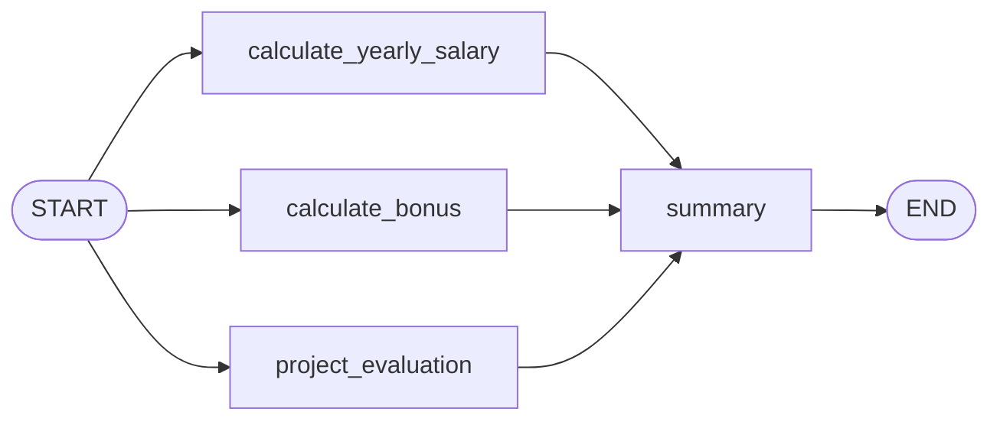
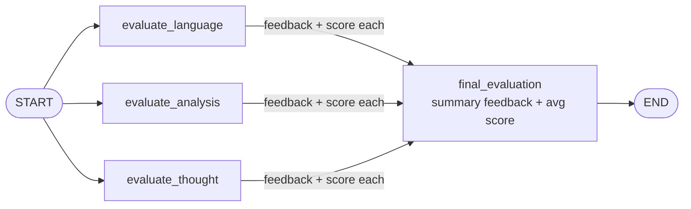

# 10 · Implement Parallel Workflows in LangGraph

> **Video:** [09:19:04](https://www.youtube.com/watch?v=Zy7EXDONlTY&t=33544s) · **Code:** [`4_Employee_analytics_Workflow.ipynb`](../../src/05-langgraph-workflows/4_Employee_analytics_Workflow.ipynb) · [`5_Essay_workflow.ipynb`](../../src/05-langgraph-workflows/5_Essay_workflow.ipynb)

In a **parallel workflow**, independent nodes run in the **same super-step** instead of waiting for each other. You get it by adding several edges **from the same source** (fan-out) and several edges **into the same target** (fan-in).

| | Sequential | Parallel |
|---|---|---|
| Edges | `A → B → C` | `START → A, B, C → D` |
| Dependency | B needs A's output | A, B, C are independent |
| Nodes return | Whole state is OK | **Only the keys they changed** |

---

## Lesson 01 · Non-LLM: employee analytics



```python
class EmployeeState(TypedDict):
    employee_name: str
    monthly_salary: int
    working_days: int
    completed_projects: int
    # computed
    yearly_salary: int
    bonus_amount: int
    project_status: str
    summary: str

def calculate_yearly_salary(state: EmployeeState):
    return {"yearly_salary": state["monthly_salary"] * 12}        # partial update only

def calculate_bonus(state: EmployeeState):
    return {"bonus_amount": state["monthly_salary"] * 2}

def project_evaluation(state: EmployeeState):
    return {"project_status": "Excellent" if state["completed_projects"] >= 5 else "Average"}

def summary(state: EmployeeState):
    return {"summary": f"Employee {state['employee_name']} has a yearly salary of "
                       f"{state['yearly_salary']} and a bonus of {state['bonus_amount']}. "
                       f"Project status is {state['project_status']}."}

graph = StateGraph(EmployeeState)
for name, fn in [("calculate_yearly_salary", calculate_yearly_salary),
                 ("calculate_bonus", calculate_bonus),
                 ("project_evaluation", project_evaluation),
                 ("summary", summary)]:
    graph.add_node(name, fn)

for n in ["calculate_yearly_salary", "calculate_bonus", "project_evaluation"]:
    graph.add_edge(START, n)          # fan-out
    graph.add_edge(n, "summary")      # fan-in: summary waits for all three
graph.add_edge("summary", END)
workflow = graph.compile()
```

### The classic error

Returning the **full** state from parallel nodes, as in the sequential lesson, fails with:

```text
InvalidUpdateError: At key 'employee_name': Can receive only one value per step.
Use an Annotated key to handle multiple values.
```

> [!IMPORTANT]
> In one super-step, three nodes each sent back `employee_name`, `monthly_salary`, … and LangGraph cannot tell which write should win. **Fix:** parallel nodes return a dict containing **only the keys they actually update**. If several branches *must* write the same key, give that key a **reducer** (next lesson).

> [!TIP]
> In Jupyter, just evaluating `workflow` on its own renders the graph. `draw_mermaid_png()` is no longer needed.

---

## Lesson 02 · LLM: UPSC-style essay evaluator



### Structured output with Pydantic

Each evaluator must reliably return **exactly** `feedback` and `score`, and free text cannot guarantee that. Bind a schema:

```python
from pydantic import BaseModel, Field

class EvaluationSchema(BaseModel):
    feedback: str = Field(description="Detailed feedback for the essay")
    score: int = Field(description="Score out of 10", ge=0, le=10)

model = ChatOpenAI(model="gpt-4o-mini")
structured_model = model.with_structured_output(EvaluationSchema)

r = structured_model.invoke(f"Evaluate the language quality of the following essay ... \n {essay}")
r.feedback, r.score
```

### Reducer: collect scores from all branches

```python
from typing import Annotated
import operator

class EssayState(TypedDict):
    essay: str
    language_feedback: str
    analysis_feedback: str
    clarity_feedback: str
    overall_feedback: str
    individual_scores: Annotated[list[int], operator.add]   # three branches append, nobody overwrites
    avg_score: float
```

```python
def evaluate_language(state: EssayState):
    out = structured_model.invoke(f"Evaluate the language quality ... \n {state['essay']}")
    return {"language_feedback": out.feedback, "individual_scores": [out.score]}   # list → appended
# evaluate_analysis / evaluate_thought: same shape, different prompt and feedback key

def final_evaluation(state: EssayState):
    overall = model.invoke(                            # plain model: free-text summary is fine here
        f"Based on the following feedbacks create a summarized feedback \n"
        f"language - {state['language_feedback']} \n analysis - {state['analysis_feedback']} \n"
        f"clarity - {state['clarity_feedback']}").content
    scores = state["individual_scores"]
    return {"overall_feedback": overall, "avg_score": sum(scores) / len(scores)}
```

With plain `list[int]` (no reducer), each branch would **replace** the list and two of the three scores would be lost.

> [!NOTE]
> Two tools introduced in this lesson: **Pydantic** for *structured LLM output* ([04](04-pydantic-data-validation.md)), and **reducers** for *safe concurrent writes* ([08](08-langgraph-core-components.md)).

## References

[1] Fan-out / fan-in and reducers. Available in [LangGraph — Branching](https://langchain-ai.github.io/langgraph/how-tos/branching/)

[2] `with_structured_output`. Available in [LangChain — Structured outputs](https://python.langchain.com/docs/concepts/structured_outputs/)
