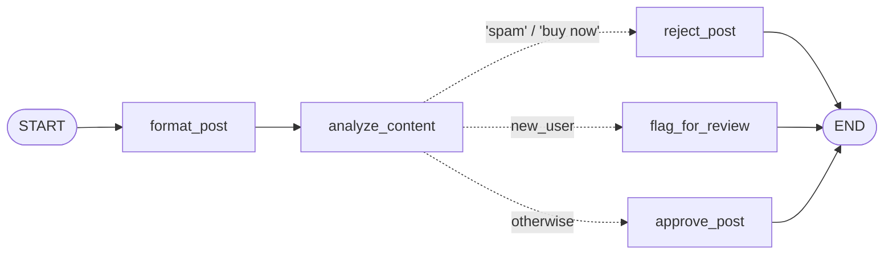
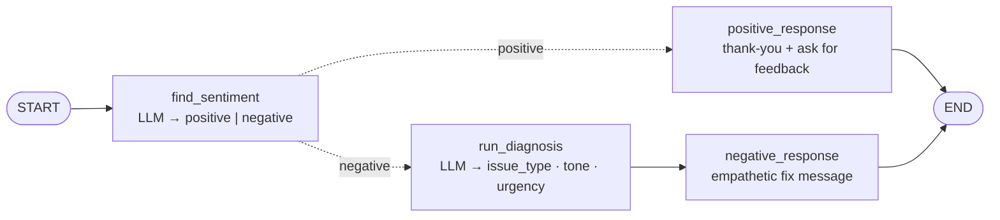

# 11 · Master Conditional Workflows in LangGraph

> **Video:** [10:15:27](https://www.youtube.com/watch?v=Zy7EXDONlTY&t=36927s) · **Code:** [`6_Content_Moderation_Workflow.ipynb`](../../src/05-langgraph-workflows/6_Content_Moderation_Workflow.ipynb) · [`7_Review_workflow.ipynb`](../../src/05-langgraph-workflows/7_Review_workflow.ipynb)

A **conditional workflow** is LangGraph's `if / elif / else`. The graph *looks* like a parallel fan-out, but **only one branch runs**, chosen at runtime.

| | Parallel ([10](10-parallel-workflows.md)) | Conditional |
|---|---|---|
| Branches executed | **All** | **Exactly one** |
| Edge API | Several `add_edge(src, x)` | One `add_conditional_edges(src, router)` |
| Reducer needed? | Often (several writers) | No, since only one branch writes |

## The router function

```python
from typing import Literal

def router(state: MyState) -> Literal["node_a", "node_b", "node_c"]:
    if ...:   return "node_a"
    elif ...: return "node_b"
    return "node_c"

graph.add_conditional_edges("decision_node", router)
```

> [!IMPORTANT]
> The router **returns the name of the next node**. The `Literal[...]` return type is the documented pattern: LangGraph uses it to draw the possible branches when rendering the graph. Alternatively, pass an explicit mapping such as `{"approved": END, "needs_improvement": "optimize"}` (see [12](12-iterative-workflows.md)).

---

## Lesson 01 · Non-LLM: social-media content moderation



```python
class ModerationState(TypedDict):
    post_content: str
    user_reputation: str      # "trusted_user" | "new_user"
    formatted_post: str
    content_flag: str         # "approved" | "review" | "rejected"
    result: str

def format_post(state):
    return {"formatted_post": f"User ({state['user_reputation']}) says: {state['post_content']}"}

def analyze_content(state):
    content = state["post_content"].lower()
    if "spam" in content or "buy now" in content: flag = "rejected"
    elif state["user_reputation"] == "new_user":   flag = "review"
    else:                                           flag = "approved"
    return {"content_flag": flag}

def approve_post(state):    return {"result": "Post published successfully to the timeline."}
def flag_for_review(state): return {"result": "Post sent to the human moderation queue."}
def reject_post(state):     return {"result": "Post automatically deleted due to policy violation."}

def check_condition(state) -> Literal["approve_post", "flag_for_review", "reject_post"]:
    if state["content_flag"] == "approved": return "approve_post"
    if state["content_flag"] == "review":   return "flag_for_review"
    return "reject_post"

graph.add_edge(START, "format_post")
graph.add_edge("format_post", "analyze_content")
graph.add_conditional_edges("analyze_content", check_condition)
for n in ["approve_post", "flag_for_review", "reject_post"]:
    graph.add_edge(n, END)
```

| Input | `content_flag` | `result` |
|---|---|---|
| "Check out this amazing new product **and buy now**", trusted | `rejected` | deleted (policy) |
| "Check out this amazing new product!", trusted | `approved` | published |
| same, `new_user` | `review` | sent to human queue |

> [!TIP]
> Wiring `analyze_content → END` first, then swapping in the conditional edge, makes it obvious that the three branch nodes are **unreachable** until the router connects them.

---

## Lesson 02 · LLM: customer-review auto-reply



Two **Pydantic schemas** constrain each LLM decision to a fixed vocabulary:

```python
class SentimentSchema(BaseModel):
    sentiment: Literal["positive", "negative"] = Field(description="Sentiment of the review")

class DiagnosisSchema(BaseModel):
    issue_type: Literal["UX", "Performance", "Bug", "Support", "Other"]
    tone:       Literal["angry", "frustrated", "disappointed", "calm"]
    urgency:    Literal["low", "medium", "high"]

structured_model  = model.with_structured_output(SentimentSchema)
structured_model2 = model.with_structured_output(DiagnosisSchema)
```

```python
class ReviewState(TypedDict):
    review: str
    sentiment: Literal["positive", "negative"]
    diagnosis: dict
    response: str

def find_sentiment(state):
    return {"sentiment": structured_model.invoke(
        f"For the following review find out the sentiment \n {state['review']}").sentiment}

def run_diagnosis(state):
    d = structured_model2.invoke(f"Diagnose this negative review:\n\n{state['review']}\n"
                                 "Return issue_type, tone, and urgency.")
    return {"diagnosis": d.model_dump()}            # Pydantic → dict for state

def negative_response(state):
    d = state["diagnosis"]
    return {"response": model.invoke(
        f"You are a support assistant. The user had a '{d['issue_type']}' issue, sounded "
        f"'{d['tone']}', and marked urgency as '{d['urgency']}'. "
        "Write an empathetic, helpful resolution message.").content}

def check_sentiment(state) -> Literal["positive_response", "run_diagnosis"]:
    return "positive_response" if state["sentiment"] == "positive" else "run_diagnosis"

graph.add_edge(START, "find_sentiment")
graph.add_conditional_edges("find_sentiment", check_sentiment)
graph.add_edge("positive_response", END)
graph.add_edge("run_diagnosis", "negative_response")
graph.add_edge("negative_response", END)
```

Negative sample → `diagnosis = {issue_type: "Performance", tone: "frustrated", urgency: "high"}` and a tailored apology.

> [!NOTE]
> Use the **structured model** wherever the output drives routing or is consumed as data. Use the **plain model** where you just want prose (thank-you or resolution messages).

## References

[1] Conditional edges. Available in [LangGraph — Graph API: conditional edges](https://langchain-ai.github.io/langgraph/concepts/low_level/#conditional-edges)

[2] Routing pattern. Available in [Anthropic — Building effective agents](https://www.anthropic.com/engineering/building-effective-agents)
