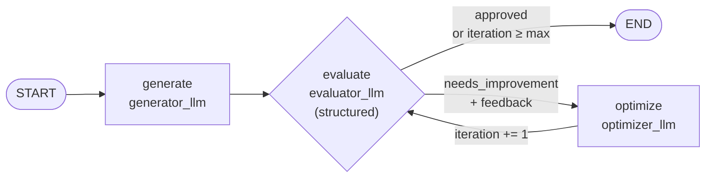

# 12 · LangGraph Iterative Workflows Explained

> **Video:** [11:06:05](https://www.youtube.com/watch?v=Zy7EXDONlTY&t=39965s) · **Code:** [`8_Iterative_Workflows.ipynb`](../../src/05-langgraph-workflows/8_Iterative_Workflows.ipynb)

An **iterative workflow** is a **loop**: a conditional edge that points *back* to an earlier node. It is the **evaluator–optimizer** pattern from [08](08-langgraph-core-components.md).

## Project: self-improving Facebook post generator

Nobody posts the first ChatGPT draft as-is. You read it, ask for tweaks, re-read it, then post. This workflow automates that loop.



---

## Lesson 01 · Three LLM roles

```python
generator_llm = ChatOpenAI(model="gpt-4o-mini")
evaluator_llm = ChatOpenAI(model="gpt-4o-mini")
optimizer_llm = ChatOpenAI(model="gpt-4o-mini")
```

> [!TIP]
> These are three objects so each role can use a **different model** in production: whichever is best at generating, at critiquing, or at rewriting.

### The evaluator must return a decision and a reason

```python
class PostEvaluation(BaseModel):
    evaluation: Literal["approved", "needs_improvement"] = Field(..., description="Final evaluation result.")
    feedback: str = Field(..., description="feedback for the Facebook post.")

structured_evaluator_llm = evaluator_llm.with_structured_output(PostEvaluation)
```

## Lesson 02 · State with history

```python
class PostState(TypedDict):
    topic: str
    post: str                                          # latest draft (replaced)
    evaluation: Literal["approved", "needs_improvement"]
    feedback: str                                      # latest feedback (replaced)
    iteration: int
    max_iteration: int
    post_history: Annotated[list[str], operator.add]       # every draft (appended)
    feedback_history: Annotated[list[str], operator.add]   # every critique (appended)
```

## Lesson 03 · Nodes with role prompts

`SystemMessage` / `HumanMessage` (from `langchain_core.messages`) give each LLM a **persona** plus **instructions**:

| Node | System persona | Key instructions |
|---|---|---|
| `generate` | *Funny and clever Facebook influencer* | Topic; no Q&A format; ≤ 500 chars; observational humor, irony, meme logic; simple English |
| `evaluate` | *Ruthless, no-laugh-given Facebook critic* | Score originality, humor, punchiness, virality, format. **Auto-reject** Q&A, > 500 chars, setup-punchline, limp endings |
| `optimize` | *Punches up posts for virality and humor* | Rewrite the original using the feedback; still ≤ 500 chars, no Q&A |

```python
def generate_post(state):
    response = generator_llm.invoke([SystemMessage(...), HumanMessage(...)]).content
    return {"post": response, "post_history": [response]}

def evaluate_post(state):
    r = structured_evaluator_llm.invoke([SystemMessage(...), HumanMessage(f"... Post: {state['post']} ...")])
    return {"evaluation": r.evaluation, "feedback": r.feedback, "feedback_history": [r.feedback]}

def optimize_post(state):
    response = optimizer_llm.invoke([SystemMessage(...), HumanMessage(
        f"Improve ... feedback: {state['feedback']} Topic: {state['topic']} Original Post: {state['post']}")]).content
    return {"post": response, "iteration": state["iteration"] + 1, "post_history": [response]}
```

## Lesson 04 · The loop

```python
def route_evaluation(state):
    if state["evaluation"] == "approved" or state["iteration"] >= state["max_iteration"]:
        return "approved"
    return "needs_improvement"

graph.add_edge(START, "generate")
graph.add_edge("generate", "evaluate")
graph.add_conditional_edges("evaluate", route_evaluation,
                            {"approved": END, "needs_improvement": "optimize"})   # label → node mapping
graph.add_edge("optimize", "evaluate")                                            # ← the back-edge
workflow = graph.compile()

result = workflow.invoke({"topic": "agentic AI", "iteration": 1, "max_iteration": 5})
for fb in result["feedback_history"]:
    print(fb)
```

> [!WARNING]
> **Always cap a loop.** Without `max_iteration`, a weak model that never satisfies the critic will loop forever (or until LangGraph's `recursion_limit`, 25 super-steps by default, raises `GraphRecursionError`).

> [!NOTE]
> With `gpt-4o-mini` the first draft was usually **approved on iteration 1**. To actually watch the loop run, use a weaker generator or a stricter critic prompt, then inspect `post_history` / `feedback_history`.

---

## Workflow recap

| Workflow | Edge shape | Lesson |
|---|---|---|
| Sequential | `A → B → C` | [09](09-sequential-workflows.md) |
| Parallel | fan-out / fan-in (+ reducers) | [10](10-parallel-workflows.md) |
| Conditional | `add_conditional_edges` → one branch | [11](11-conditional-workflows.md) |
| Iterative | conditional edge **back** to an earlier node | this one |

## References

[1] Evaluator–optimizer pattern. Available in [Anthropic — Building effective agents](https://www.anthropic.com/engineering/building-effective-agents)

[2] `recursion_limit` and loops. Available in [LangGraph — Recursion limit](https://langchain-ai.github.io/langgraph/concepts/low_level/#recursion-limit)
