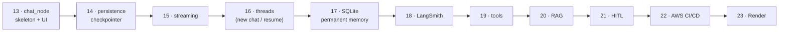
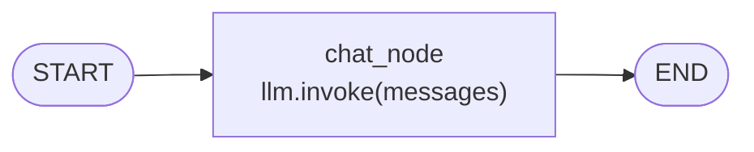

# 13 · Build Your First Agentic Chatbot with LangGraph

> **Video:** [11:35:51](https://www.youtube.com/watch?v=Zy7EXDONlTY&t=41751s) · **Code:** [`src/06-agentic-chatbot/`](../../src/06-agentic-chatbot/): [`agentic_chatbot_backend.py`](../../src/06-agentic-chatbot/agentic_chatbot_backend.py), [`non_stream.py`](../../src/06-agentic-chatbot/non_stream.py), [`app_simple.py`](../../src/06-agentic-chatbot/app_simple.py), [`notebooks/Chatbot_workflow.ipynb`](../../src/06-agentic-chatbot/notebooks/Chatbot_workflow.ipynb) · **Diagram:** [`13-agentic-chatbot.excalidraw`](../diagrams/13-agentic-chatbot.excalidraw)

## Project roadmap (chapters 13–23)

The chatbot grows **one LangGraph concept per chapter**:



## Lesson 01 · The skeleton graph



```python
from typing import TypedDict, Annotated
from langchain_core.messages import BaseMessage, HumanMessage
from langgraph.graph import StateGraph, START, END
from langgraph.graph.message import add_messages

class ChatState(TypedDict):
    messages: Annotated[list[BaseMessage], add_messages]    # append, never overwrite

def chat_node(state: ChatState):
    response = llm.invoke(state["messages"])                 # full history → LLM
    return {"messages": [response]}                          # reducer appends the AIMessage

graph = StateGraph(ChatState)
graph.add_node("chat_node", chat_node)
graph.add_edge(START, "chat_node")
graph.add_edge("chat_node", END)
chatbot = graph.compile()

res = chatbot.invoke({"messages": [HumanMessage(content="What is OOP?")]})
res["messages"][-1].content           # [HumanMessage, AIMessage] → last one is the reply
```

> [!NOTE]
> `BaseMessage` is the parent of `HumanMessage`, `AIMessage`, `SystemMessage` and `ToolMessage`, so the list holds the whole conversation. `add_messages` is the chat-specific reducer: it appends, and de-duplicates by message `id`.

## Lesson 02 · Why it forgets your name

In a `while True: input() → chatbot.invoke(...)` loop:

```text
You: My name is Bappy     AI: Nice to meet you, Bappy!
You: What is my name?     AI: Sorry, I don't have access to personal information.
```

> [!IMPORTANT]
> State lives only for **one** run, from `START` to `END`. Each `invoke` starts from empty state, so the earlier turn is gone. The fix is **persistence**: store state outside the run.

## Lesson 03 · Persistence preview: `MemorySaver` + `thread_id`

```python
from langgraph.checkpoint.memory import MemorySaver

checkpoint = MemorySaver()                                   # state saved in RAM
chatbot = graph.compile(checkpointer=checkpoint)

config = {"configurable": {"thread_id": "1"}}               # one conversation = one thread
chatbot.invoke({"messages": [HumanMessage(content="My name is Bappy")]}, config=config)
chatbot.invoke({"messages": [HumanMessage(content="What is my name?")]}, config=config)  # → Bappy
```

| Thread | Says | "What is my name?" |
|---|---|---|
| `thread_id = 1` | "My name is Bappy" | **Bappy** |
| `thread_id = 2` | "My name is Alex" | **Alex** |
| `thread_id = 1` again | — | **Bappy**. Threads are isolated, like separate ChatGPT chats |

`chatbot.get_state(config)` returns the saved **state snapshot** (messages, token usage metadata, thread id).

---

## Lesson 04 · Streamlit UI

Backend (`agentic_chatbot_backend.py`) exports `chatbot`. The UI imports it.

```python
import streamlit as st
st.title("Agentic Chatbot with LangGraph")
CONFIG = {"configurable": {"thread_id": "thread-1"}}

if "message_history" not in st.session_state:          # survives Streamlit reruns
    st.session_state["message_history"] = []

for m in st.session_state["message_history"]:           # replay history on every rerun
    with st.chat_message(m["role"]):
        st.text(m["content"])

user_input = st.chat_input("Type here")
if user_input:
    st.session_state["message_history"].append({"role": "user", "content": user_input})
    with st.chat_message("user"):
        st.text(user_input)

    response = chatbot.invoke({"messages": [HumanMessage(content=user_input)]}, config=CONFIG)
    ai_message = response["messages"][-1].content
    st.session_state["message_history"].append({"role": "assistant", "content": ai_message})
    with st.chat_message("assistant"):
        st.text(ai_message)
```

```bash
streamlit run non_stream.py     # http://localhost:8501
```

> [!TIP]
> **Streamlit reruns the whole script on every interaction**, so without `st.session_state` earlier messages vanish from the screen. This is the *UI* counterpart of the LangGraph checkpointer.

## Lesson 05 · Streaming preview

Long answers make users wait for the whole generation. ChatGPT-style **token streaming** replaces `invoke` with `stream(..., stream_mode="messages")` and `st.write_stream`. This is what [`app_simple.py`](../../src/06-agentic-chatbot/app_simple.py) does; details in [15](15-streaming-responses.md).

> [!WARNING]
> `AttributeError: module 'streamlit' has no attribute 'write_stream'` means Streamlit is too old: `pip install --upgrade streamlit`.

## References

[1] `add_messages`, `MessagesState`. Available in [LangGraph — Messages in state](https://langchain-ai.github.io/langgraph/concepts/low_level/#messages)

[2] `chat_input`, `chat_message`, `session_state`. Available in [Streamlit — Chat elements](https://docs.streamlit.io/develop/api-reference/chat)
