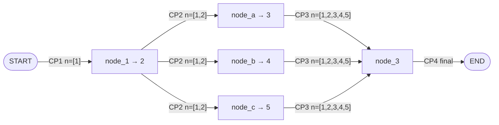
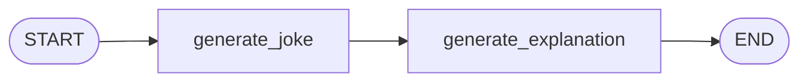

# 14 · Why Persistence is Required in LangGraph

> **Video:** [12:43:49](https://www.youtube.com/watch?v=Zy7EXDONlTY&t=45829s) · **Code:** [`9_Persistence.ipynb`](../../src/05-langgraph-workflows/9_Persistence.ipynb) · **Diagram:** [`14-langgraph-persistence.excalidraw`](../diagrams/14-langgraph-persistence.excalidraw)

> [!IMPORTANT]
> **Persistence** is LangGraph's built-in layer that **automatically saves and restores graph state over time**. A **checkpointer** captures a **snapshot of state at every super-step** and files the snapshots under unique, retrievable **threads**.

## The problem

A graph's state lives from `START` to `END`. When the run ends, state is gone, so the next `invoke` cannot know what happened before. Persistence writes state to a store:

| Store | Class | Lifetime |
|---|---|---|
| RAM | `InMemorySaver` / `MemorySaver` | Until the process / kernel restarts |
| Database | `SqliteSaver`, `PostgresSaver`, … | Permanent ([17](17-database-persistence.md)) |

---

## Concept 1 · Intermediate *and* final state

Persistence does not keep only the final result. It keeps **every intermediate snapshot**.



With `numbers: Annotated[list[int], operator.add]`, every super-step **appends**. Each checkpoint (CP1 to CP4) records the state *at that moment*, which is what makes resume, HITL and time travel possible.

## Concept 2 · Checkpointer

A checkpointer is the **tracker**: after each super-step it writes the updated state to the store.

```python
from langgraph.checkpoint.memory import InMemorySaver
workflow = graph.compile(checkpointer=InMemorySaver())
```

## Concept 3 · Threads

A **thread** is one independent conversation / run, keyed by `thread_id`. The same graph can serve many threads without leaking state between them, like ChatGPT's sidebar of chats.

| Store | How threads are separated |
|---|---|
| RAM | A separate slot per `thread_id` |
| Database | A `thread_id` column; fetch rows by id |

---

## Code walkthrough: joke + explanation



```python
class JokeState(TypedDict):
    topic: str
    joke: str
    explanation: str

def generate_joke(state):        return {"joke": llm.invoke(f"generate a joke on the topic {state['topic']}").content}
def generate_explanation(state): return {"explanation": llm.invoke(f"write an explanation for the joke - {state['joke']}").content}

workflow = graph.compile(checkpointer=InMemorySaver())

config1 = {"configurable": {"thread_id": "1"}}
workflow.invoke({"topic": "Football"}, config=config1)
workflow.get_state(config1)                     # latest snapshot
list(workflow.get_state_history(config1))       # every checkpoint, newest first

config2 = {"configurable": {"thread_id": "2"}}
workflow.invoke({"topic": "Cricket"}, config=config2)   # thread 1 untouched
```

`get_state_history` for one run shows **four** snapshots: (1) input only, (2) `topic` set, (3) `topic + joke`, (4) `topic + joke + explanation`. Each has a `checkpoint_id`.

> [!TIP]
> **Switching providers when credits run out:** the notebook uses Gemini (`langchain-google-genai`, `ChatGoogleGenerativeAI(model="gemini-2.5-flash")`, `GOOGLE_API_KEY` from Google AI Studio). `gemini-1.5-*` returned *model not found*, so use 2.5.

---

## Four benefits

### 1 · Short-term memory

The chatbot in [13](13-first-agentic-chatbot.md) remembers *"My name is Bappy"* within a thread.

### 2 · Fault tolerance: resume after a crash

```python
def step_2(state):
    time.sleep(30)                 # interrupt the kernel here to simulate a crash
    return {"step2": "done"}

graph = builder.compile(checkpointer=InMemorySaver())
cfg = {"configurable": {"thread_id": "thread-1"}}

try:
    graph.invoke({"input": "start"}, config=cfg)       # step_1 ✅, step_2 ⏳ → interrupted
except KeyboardInterrupt:
    print("crash simulated")

graph.invoke(None, config=cfg)                         # input=None → resume from step_2, NOT step_1
```

> [!NOTE]
> Passing **`None`** as input tells LangGraph *"continue this thread from its last checkpoint"*. The demo ran in Google Colab because VS Code would not interrupt the cell cleanly.

### 3 · Human-in-the-loop

Example: *topic → generate Facebook post → **wait for human approval** → publish*. Approval might come in a minute or a week, and you should not keep compute running all that time. The graph **stops at the checkpoint**, and when the human answers it **resumes from that node** rather than regenerating the post. Covered in depth in [21](21-human-in-the-loop.md).

### 4 · Time travel: debug and replay

```python
# inspect a specific past checkpoint
workflow.get_state({"configurable": {"thread_id": "2", "checkpoint_id": "<id>"}})

# replay forward from a past checkpoint (creates new checkpoints)
workflow.invoke(None, {"configurable": {"thread_id": "2", "checkpoint_id": "<id>"}})

# edit history: change the topic at the first checkpoint, then re-run
workflow.update_state(
    {"configurable": {"thread_id": "2", "checkpoint_id": "<id>", "checkpoint_ns": ""}},
    {"topic": "Tennis"},
)
```

> [!TIP]
> Time travel is a **debugging** tool: jump to any node's snapshot, change state, and see how the rest of the graph reacts.

## References

[1] Checkpointers, threads, state history, replay, update_state. Available in [LangGraph — Persistence](https://langchain-ai.github.io/langgraph/concepts/persistence/)

[2] Time travel. Available in [LangGraph — Time travel](https://langchain-ai.github.io/langgraph/concepts/time-travel/)
