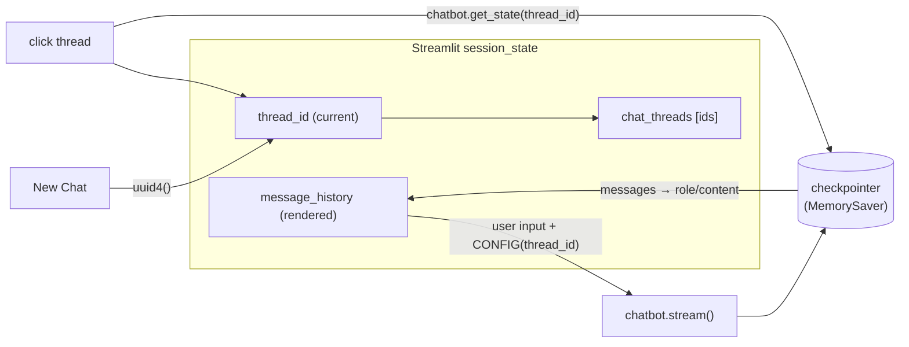

# 16 · How to Add Chat Threading in Agentic Chatbot using LangGraph

> **Video:** [14:10:02](https://www.youtube.com/watch?v=Zy7EXDONlTY&t=51002s) · **Code:** [`app_thread.py`](../../src/06-agentic-chatbot/app_thread.py) (backend unchanged: [`agentic_chatbot_backend.py`](../../src/06-agentic-chatbot/agentic_chatbot_backend.py))

## Goal: a ChatGPT-style sidebar

Until now every message went to a hard-coded `thread_id = "thread-1"`. This chapter adds:

* **New Chat**: start a fresh thread with a new UUID.
* **My Conversations**: list every thread, newest first.
* **Resume**: click a thread to reload its history from the **LangGraph checkpointer** and continue it.



> [!IMPORTANT]
> **The backend does not change.** Threading is just *which* `thread_id` the UI sends in `config`. The checkpointer already keeps threads apart ([14](14-persistence.md)).

---

## Lesson 01 · Utilities

```python
import uuid

def generate_thread_id():
    return str(uuid.uuid4())

def add_thread(thread_id):
    if thread_id not in st.session_state["chat_threads"]:
        st.session_state["chat_threads"].append(thread_id)

def reset_chat():                                  # "New Chat"
    st.session_state["thread_id"] = generate_thread_id()
    st.session_state["message_history"] = []
    add_thread(st.session_state["thread_id"])

def load_conversation(thread_id):                  # read history back from LangGraph
    state = chatbot.get_state(config={"configurable": {"thread_id": thread_id}})
    return state.values.get("messages", [])
```

## Lesson 02 · Session-state bootstrapping

```python
if "message_history" not in st.session_state: st.session_state["message_history"] = []
if "thread_id"       not in st.session_state: st.session_state["thread_id"] = generate_thread_id()
if "chat_threads"    not in st.session_state: st.session_state["chat_threads"] = []
add_thread(st.session_state["thread_id"])
```

## Lesson 03 · Sidebar

```python
st.sidebar.title("My Conversations")

if st.sidebar.button("New Chat"):
    reset_chat()
    st.rerun()                                     # redraw with the empty chat

for thread_id in st.session_state["chat_threads"][::-1]:          # newest first
    if st.sidebar.button(str(thread_id), key=thread_id):
        st.session_state["thread_id"] = thread_id
        temp = []
        for m in load_conversation(thread_id):
            if isinstance(m, HumanMessage): role = "user"
            elif isinstance(m, AIMessage):  role = "assistant"
            else: continue                                         # skip ToolMessage etc.
            temp.append({"role": role, "content": m.content})
        st.session_state["message_history"] = temp
        st.rerun()
```

> [!NOTE]
> `[::-1]` is needed because new threads are **appended** to the end of the list, but the UI should show the most recent chat on top.

## Lesson 04 · Chat with the *current* thread

```python
CONFIG = {"configurable": {"thread_id": st.session_state["thread_id"]}}   # dynamic, not hard-coded

with st.chat_message("assistant"):
    ai_message = st.write_stream(
        chunk.content
        for chunk, _ in chatbot.stream({"messages": [HumanMessage(content=user_input)]},
                                       config=CONFIG, stream_mode="messages")
        if isinstance(chunk, AIMessage)
    )
```

### Demo

| Thread | Messages | Later question | Answer |
|---|---|---|---|
| A | "My name is Bappy" · "I love cricket" | "What is my favourite sport?" | Cricket |
| B (New Chat) | "My name is Alex" · "I love football" | "What is my name?" | Alex |
| back to A | — | "Show hello world" | Python code (A was about Python) |

> [!TIP]
> **Improvement:** show a readable **title** instead of the UUID, e.g. ask the LLM to summarise the first user message into 3–5 words, as ChatGPT does.

> [!WARNING]
> Threads still live in `MemorySaver` (RAM), and `chat_threads` lives in Streamlit's session. **Restart the app and all of it is gone.** Fixed in [17](17-database-persistence.md).

## References

[1] Threads and `get_state`. Available in [LangGraph — Persistence: threads](https://langchain-ai.github.io/langgraph/concepts/persistence/#threads)

[2] `st.sidebar`, `st.rerun`. Available in [Streamlit API reference](https://docs.streamlit.io/develop/api-reference)
