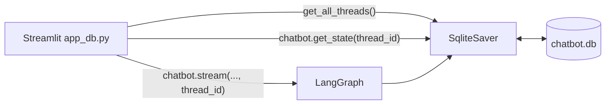

# 17 · Build Permanent Chat Persistence Memory with LangGraph and a Database

> **Video:** [14:42:02](https://www.youtube.com/watch?v=Zy7EXDONlTY&t=52922s) · **Code:** [`agentic_chatbot_db_backend.py`](../../src/06-agentic-chatbot/agentic_chatbot_db_backend.py) · [`app_db.py`](../../src/06-agentic-chatbot/app_db.py)

## The problem

With `MemorySaver`, **refreshing the page or restarting the app wipes every thread**, because RAM is temporary. ChatGPT keeps your chats after you close the browser or reboot, since they are in a database.

| Checkpointer | Package | Use for |
|---|---|---|
| `InMemorySaver` | `langgraph` | Demos and tests |
| **`SqliteSaver`** | `langgraph-checkpoint-sqlite` | **Prototypes**: a single local file, free, no server |
| `PostgresSaver` | `langgraph-checkpoint-postgres` | Production (self-hosted, Render, AWS RDS…) |
| MongoDB / Redis / … | community packages | Production |

> [!NOTE]
> Switching databases means changing **only the checkpointer line** (plus its connection string). The graph code does not change.

---

## Lesson 01 · Backend: swap the checkpointer

```bash
pip install langgraph-checkpoint-sqlite
```

```python
import sqlite3
from langgraph.checkpoint.sqlite import SqliteSaver

conn = sqlite3.connect(database="chatbot.db", check_same_thread=False)
checkpoint = SqliteSaver(conn)
chatbot = graph.compile(checkpointer=checkpoint)        # everything else unchanged
```

> [!IMPORTANT]
> `check_same_thread=False` is required. Streamlit (and the checkpointer) access the connection from **multiple Python threads**, and SQLite refuses that by default.

Test from the backend file itself:

```python
config = {"configurable": {"thread_id": "default-thread"}}
chatbot.invoke({"messages": [HumanMessage(content="My name is Bappy")]}, config=config)
```

`chatbot.db` appears in the project folder.

> [!TIP]
> Install the **SQLite Viewer** VS Code extension (publisher *Florian Klampfer*) to browse `chatbot.db`. Each turn writes **3 checkpoint rows** (input, `chat_node`, end) with `thread_id` and `checkpoint_id`. Payloads are serialized binary, but fragments such as *"My name is Bappy"* are visible.

## Lesson 02 · List every thread from the DB

```python
def get_all_threads():
    all_threads = set()                                   # many checkpoints per thread → dedupe
    for ckpt in checkpoint.list(None):                    # None = all threads
        all_threads.add(ckpt.config["configurable"]["thread_id"])
    return list(all_threads)
```

## Lesson 03 · Frontend: one line changes

```python
from agentic_chatbot_db_backend import chatbot, get_all_threads

if "chat_threads" not in st.session_state:
    st.session_state["chat_threads"] = get_all_threads()  # was: []
```



### Result

1. Thread A: "I'm Bappy, a teacher". Thread B: "I'm Alex, a learner".
2. **Refresh the page**: both threads are still listed.
3. **Stop and restart `streamlit run app_db.py`**: both threads are still listed.
4. In B, "Who am I?" → *Alex, a learner*. In A → *Bappy, a teacher*.

> [!WARNING]
> `chatbot.db` stores **real conversation history**. It is listed in [`.gitignore`](../../.gitignore) (`*.db`, `*.db-wal`, `*.db-shm`), and the copy in the upstream repo was intentionally **not** included in this repository.

> [!NOTE]
> The backend also falls back to **Gemini** (`ChatGoogleGenerativeAI("gemini-2.5-flash")`). Uncomment `ChatOpenAI()` if you have OpenAI credit.

## References

[1] Checkpointer back-ends. Available in [LangGraph — Add memory](https://langchain-ai.github.io/langgraph/how-tos/memory/add-memory/)

[2] Package. Available in [PyPI — langgraph-checkpoint-sqlite](https://pypi.org/project/langgraph-checkpoint-sqlite/)
