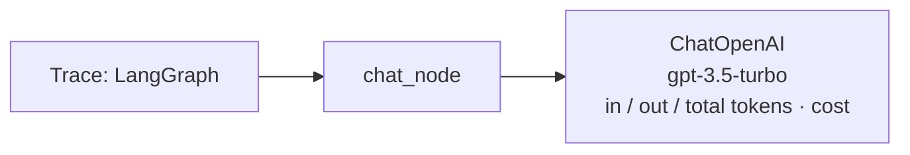

# 18 · Monitor Your Agentic Chatbot with LangSmith & LangGraph

> **Video:** [15:16:31](https://www.youtube.com/watch?v=Zy7EXDONlTY&t=54991s) · **Code:** [`app_db.py`](../../src/06-agentic-chatbot/app_db.py) (`metadata` + `run_name` in `CONFIG`) · [`.env.example`](../../src/06-agentic-chatbot/.env.example)

> [!IMPORTANT]
> **LangSmith** is a **debugging, monitoring and evaluation** platform for LLM apps and agents. It is built by the LangChain team but works with non-LangChain code too. It records each execution as a **trace**: inputs, outputs, errors, latency, token usage and cost, tool calls and model behaviour at every step.

## Why observability

Between *user question* and *final answer* there are many **hidden steps**: prompt construction, LLM call, tool or DB call, memory / checkpointer reads. Without tracing you see only the ends. With LangSmith you can:

| Need | What you look at |
|---|---|
| Why did the agent pick the **wrong tool**? | Step-by-step trace: query → prompt → LLM → tool |
| Was the **exact prompt** right? | LLM run inputs |
| Which **node failed**? | Errored span in the LangGraph trace |
| Why is it **slow / expensive**? | Latency, input / output / total tokens, estimated cost per span |
| What happened in **this conversation**? | **Threads** view (multi-turn) |
| Did prompt v2 beat v1? | Compare runs / experiments |
| Quality before vs after deploy | Datasets + evaluations |

---

## Lesson 01 · Zero-code setup

1. Sign up at **smith.langchain.com** (Google / GitHub / Discord).
2. *Settings → API Keys → Create API key*.
3. Add to `.env`:

```dotenv
LANGSMITH_TRACING=true
LANGSMITH_ENDPOINT=https://api.smith.langchain.com
LANGSMITH_API_KEY=<your key>
LANGSMITH_PROJECT=agentic-chatbot
```

4. Restart `streamlit run app_db.py`. **No code change.** LangChain / LangGraph detect the variables and start sending traces.

> [!TIP]
> Only `LANGSMITH_PROJECT` changes between projects. Every first run auto-creates the project in the dashboard.

## Lesson 02 · Reading a trace



* **Chat view**: the input message and the AI reply, rendered like a chat.
* **Details view**: the span tree (graph, node, model), each with input / output / attributes. Hover for token counts and cost.
* **Right panel**: start time, latency, tokens, cost, metadata, endpoint.

## Lesson 03 · Group runs by conversation thread

By default every message is a separate trace named `LangGraph`, and messages from different chats look the same. Add **`metadata.thread_id`** and a **`run_name`** to the config:

```python
CONFIG = {
    "configurable": {"thread_id": st.session_state["thread_id"]},
    "metadata":     {"thread_id": st.session_state["thread_id"]},   # LangSmith groups by this
    "run_name":     "chat_trace",                                   # replaces the default "LangGraph"
}
```

The project now has a **Threads** tab: one row per conversation, with turns 1, 2, 3… inside it.

> [!NOTE]
> New runs can take **10–20 s** to appear in the Threads view.

> [!WARNING]
> Traces contain **full prompts and user messages**. Treat the LangSmith project as sensitive data, and keep `LANGSMITH_API_KEY` out of Git.

## References

[1] Tracing quickstart and env vars. Available in [LangSmith docs](https://docs.smith.langchain.com/)

[2] Threads. Available in [LangSmith — Threads](https://docs.smith.langchain.com/observability/how_to_guides/threads)
