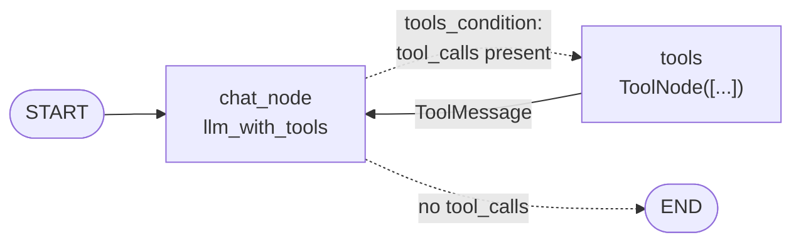

# 19 · How to Integrate Tools in Agentic Chatbot with LangGraph

> **Video:** [15:40:24](https://www.youtube.com/watch?v=Zy7EXDONlTY&t=56424s) · **Code:** [`notebooks/tools_demo.ipynb`](../../src/06-agentic-chatbot/notebooks/tools_demo.ipynb) · [`agentic_chatbot_tool_backend.py`](../../src/06-agentic-chatbot/agentic_chatbot_tool_backend.py) · [`app_tool.py`](../../src/06-agentic-chatbot/app_tool.py)

## Why tools

Without tools the chatbot is limited to the model's training data. Ask it *"latest AI news"*, *"Apple stock price"* or *"weather in New York"* and it replies *"I don't have real-time access…"*. ChatGPT answers the same questions because it **calls tools** (web search, finance, weather).

> [!IMPORTANT]
> In agentic AI, **tools** are external functions, APIs, databases or services an agent can use to **take actions beyond generating text**: search, calculate, retrieve data, execute code, update a DB, or talk to other systems.

| Common tool | Does |
|---|---|
| Web search | Current information |
| Calculator | Exact arithmetic |
| Database | Read / write records |
| RAG retriever | Search your documents / vector DB ([20](20-rag-in-chatbot.md)) |
| Python / code | Run code, analyse data |
| Email / Calendar | Read, draft, send; schedule |
| Domain APIs | Weather, finance, CRM, payments |
| Custom business | Create tickets, check inventory, update customer records |

### The tool-calling loop

1. User sends a request, and the agent works out the goal.
2. The agent **decides whether a tool is needed**, **picks the tool**, and **generates its arguments**.
3. The tool runs, and its **raw result goes back to the LLM**.
4. The LLM writes a **readable final answer** (`2125.0` becomes *"25 % of 8,500 is 2,125"*).

---

## Graph change



| Prebuilt | What it is |
|---|---|
| **`ToolNode(tools)`** | A ready-made node: reads the `tool_calls` on the last AIMessage, **routes each call to the right tool**, and appends `ToolMessage` results to state |
| **`tools_condition`** | A ready-made router: goes to `"tools"` if the last message has `tool_calls`, otherwise to `END` |

> [!WARNING]
> Forget the `tools → chat_node` back-edge and the graph ends on the **raw tool output** (JSON / numbers / metadata) instead of a human-friendly answer.

## Lesson 01 · Define tools

```python
from langchain_tavily import TavilySearch          # pip install langchain-tavily tavily-python
from langchain_core.tools import tool

search_tool = TavilySearch(max_results=5, topic="general", search_depth="advanced")   # prebuilt

@tool
def calculator(expression: str) -> str:
    """Useful for simple math calculations. Input should be a valid math expression.
    Example: 2 + 2, math.sqrt(16), 10 * 5"""
    allowed = {"math": math, "abs": abs, "round": round, "min": min, "max": max, "sum": sum}
    try:
        return str(eval(expression, {"__builtins__": {}}, allowed))
    except Exception as e:
        return f"Calculation error: {e}"

@tool
def get_stock_price(symbol: str) -> dict:
    """Fetch latest stock price for a given symbol (e.g. 'AAPL', 'TSLA') using Alpha Vantage."""
    url = ("https://www.alphavantage.co/query?function=GLOBAL_QUOTE"
           f"&symbol={symbol}&apikey={os.getenv('ALPHAVANTAGE_API_KEY')}")
    return requests.get(url).json()

@tool
def get_current_weather(location: str) -> str:
    """Get the current real-time weather for a given city or location."""
    # OpenWeather: geocode name → lat/lon → /data/2.5/weather (metric); handles timeout / 401 / bad payload
    ...
```

> [!TIP]
> Any Python function becomes a tool with `@tool`. **The docstring and type hints are the tool's spec**: the LLM reads them to decide *when* to call it and *with what arguments*. Ask ChatGPT for a function (as was done here for weather), paste it in, decorate it, and add it to the list.

| Key | Where |
|---|---|
| `TAVILY_API_KEY` | tavily.com |
| `ALPHAVANTAGE_API_KEY` | alphavantage.co → *Get free API key* |
| `OPENWEATHER_API_KEY` | openweathermap.org → *API keys* |
| `GOOGLE_API_KEY` | aistudio.google.com (Gemini, used while OpenAI credit is exhausted) |

> [!CAUTION]
> The upstream code hard-coded an Alpha Vantage key inside the URL. In this repo it is read from `ALPHAVANTAGE_API_KEY`. **Never put keys in source code.** The `calculator` uses `eval` with builtins stripped, which is acceptable for a demo but not a real sandbox.

## Lesson 02 · Bind tools and wire the graph

```python
tools = [search_tool, calculator, get_stock_price, get_current_weather]
llm_with_tools = llm.bind_tools(tools)              # LLM now knows the tool schemas

def chat_node(state: ChatState):
    return {"messages": [llm_with_tools.invoke(state["messages"])]}   # NOT plain `llm`

graph.add_node("chat_node", chat_node)
graph.add_node("tools", ToolNode(tools))
graph.add_edge(START, "chat_node")
graph.add_conditional_edges("chat_node", tools_condition)
graph.add_edge("tools", "chat_node")
chatbot = graph.compile(checkpointer=SqliteSaver(conn))
```

> [!WARNING]
> Two easy bugs, both hit while recording: (1) calling the plain `llm` inside `chat_node`, so tools are never used; (2) leaving a tool out of the `bind_tools` / `ToolNode` list (the weather tool "didn't work" until it was added).

| Prompt | Tool(s) used |
|---|---|
| "Hello!" | none |
| "What is 8989898*90909090+5404040?" | `calculator` |
| "New movie releases in 2026" | `tavily_search` |
| "Apple stock price, then cost of 50 shares" | `get_stock_price` → `calculator` (**chained**) |
| "Current weather in New York" | `get_current_weather` |

> [!NOTE]
> Gemini returns `content` as a **list of parts**, so use `out["messages"][-1].content[0]["text"]` to get the plain text.

## Lesson 03 · Show tool activity in the UI

```python
with st.chat_message("assistant"):
    status_holder = {"box": None}

    def ai_only_stream():
        for chunk, _ in chatbot.stream({"messages": [HumanMessage(content=user_input)]},
                                       config=CONFIG, stream_mode="messages"):
            if isinstance(chunk, ToolMessage):                       # a tool just ran
                name = getattr(chunk, "name", "tool")
                if status_holder["box"] is None:
                    status_holder["box"] = st.status(f"🔧 Using `{name}` …", expanded=True)
                else:
                    status_holder["box"].update(label=f"🔧 Using `{name}` …", state="running")
            if isinstance(chunk, AIMessage):
                yield chunk.content                                  # stream only assistant text

    ai_message = st.write_stream(ai_only_stream())
    if status_holder["box"] is not None:
        status_holder["box"].update(label="✅ Tool finished", state="complete", expanded=False)
```

In **LangSmith** ([18](18-langsmith-monitoring.md)) the trace now reads: `chat_node` → LLM (*tool_call: get_current_weather("New York")*) → `tools` → `get_current_weather` → `chat_node` → final answer.

## References

[1] `ToolNode`, `tools_condition`. Available in [LangGraph — Tool calling](https://langchain-ai.github.io/langgraph/how-tos/tool-calling/)

[2] `@tool`, `bind_tools`. Available in [LangChain — Tools](https://python.langchain.com/docs/concepts/tools/)

[3] Stock quote API. Available in [Alpha Vantage](https://www.alphavantage.co/documentation/)

[4] Weather + geocoding APIs. Available in [OpenWeather](https://openweathermap.org/api)
