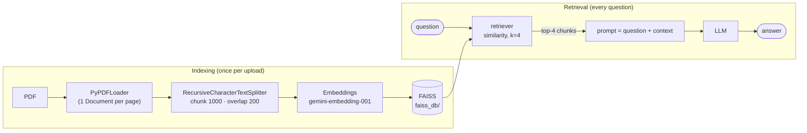

# 20 · Implement RAG in Agentic Chatbot with LangGraph

> **Video:** [16:54:17](https://www.youtube.com/watch?v=Zy7EXDONlTY&t=60857s) · **Code:** [`notebooks/rag_demo.ipynb`](../../src/06-agentic-chatbot/notebooks/rag_demo.ipynb) · [`agentic_chatbot_rag_backend.py`](../../src/06-agentic-chatbot/agentic_chatbot_rag_backend.py) · [`app_rag.py`](../../src/06-agentic-chatbot/app_rag.py)

## Goal

Upload a PDF in the chat box (like ChatGPT's attachment button) and ask questions about it, while the web-search, calculator, stock and weather tools keep working. The demo PDF is the instructor's paper *"Development of Multiple Combined Regression Method for Rainfall Measurement"* ([`notebooks/my_paper.pdf`](../../src/06-agentic-chatbot/notebooks/my_paper.pdf)).

## Why RAG

| Problem | How RAG helps |
|---|---|
| **Outdated knowledge** (cutoff) | Add fresh documents instead of fine-tuning, which is costly in compute, money and data |
| **Private data** | Your papers, policies, inventory are not in any model's training set |
| **Hallucination** | The model answers *from retrieved text*, not invented facts or URLs |

## From in-context learning to RAG

**In-context learning:** paste the whole document plus the question into the prompt. This breaks when the document (say 5k tokens) exceeds the model's input limit, and it wastes tokens on irrelevant pages.

**RAG:** index once, then retrieve only the relevant pieces.



> [!NOTE]
> **Chunk overlap** (200) repeats the tail of one chunk at the head of the next, so a sentence cut at a boundary still has its context. `chunk_size` and `k` are tunable hyperparameters. The 15-page paper produced **44 chunks**.

---

## Lesson 01 · Notebook: build the retriever

```python
from langchain_community.document_loaders import PyPDFLoader
from langchain_text_splitters import RecursiveCharacterTextSplitter
from langchain_community.vectorstores import FAISS
from langchain_google_genai import GoogleGenerativeAIEmbeddings   # or OpenAIEmbeddings

docs   = PyPDFLoader("my_paper.pdf").load()
chunks = RecursiveCharacterTextSplitter(chunk_size=1000, chunk_overlap=200).split_documents(docs)
store  = FAISS.from_documents(chunks, GoogleGenerativeAIEmbeddings(model="gemini-embedding-001"))
store.save_local("faiss_db")                                 # local, on-disk vector DB (by Meta)

retriever = store.as_retriever(search_type="similarity", search_kwargs={"k": 4})
retriever.invoke("What is rainfall measurement?")            # → 4 most similar chunks
```

```bash
pip install langchain-community faiss-cpu pypdf langchain-text-splitters langchain-google-genai
```

> [!TIP]
> FAISS lives on local disk. Weaviate, Chroma and Pinecone are alternatives, including cloud-hosted ones ([Advanced RAG](../../src/07-advanced-rag/) uses Pinecone).

## Lesson 02 · Retriever → tool

An agent acts through **tools**, so RAG becomes one more tool next to search / calculator / stock / weather:

```python
@tool
def rag_tool(query: str) -> str:
    """Retrieve relevant information from the PDF document.
    Use this tool when the user asks factual or conceptual questions
    that may be answered using the stored PDF documents."""
    docs = get_retriever().invoke(query)
    if not docs:
        return "No relevant information was found in the PDF."
    return "\n\n".join(f"[source: {d.metadata.get('source')} p.{d.metadata.get('page')}]\n{d.page_content}"
                       for d in docs)

tools = [search_tool, calculator, get_stock_price, get_current_weather, rag_tool]
llm_with_tools = llm.bind_tools(tools)
```

## Lesson 03 · Backend

```python
def ingest_rag_document(file_path):            # called by the UI on upload
    docs   = PyPDFLoader(file_path).load()
    chunks = RecursiveCharacterTextSplitter(chunk_size=1000, chunk_overlap=200).split_documents(docs)
    FAISS.from_documents(chunks, embeddings).save_local("faiss_db")

def get_retriever():
    store = FAISS.load_local("faiss_db", embeddings, allow_dangerous_deserialization=True)
    return store.as_retriever(search_type="similarity", search_kwargs={"k": 4})
```

> [!CAUTION]
> `allow_dangerous_deserialization=True` unpickles `index.pkl`. Only load an index **your own app wrote**, never one downloaded from elsewhere. For this reason the upstream `faiss_db/` folder was **not** copied into this repo (and `faiss_db/` and `*.pkl` are git-ignored). It is rebuilt on your first upload.

### A system prompt that routes tools

As tools multiply, the model needs explicit routing rules:

```python
system_message = SystemMessage(content=(
    "You are a helpful Agentic Chatbot with access to several tools.\n\n"
    "- Use `rag_tool` for questions about the uploaded PDF or document. Always retrieve before answering.\n"
    "- Use `search_tool` for current events / anything needing internet search.\n"
    "- Use `calculator` for math; do not compute complex expressions manually.\n"
    "- Use `get_stock_price` for stock prices; `get_current_weather` for weather.\n\n"
    "Answer general questions directly. Do not invent information from the document. "
    "If the user asks about a PDF but none is available, ask them to upload one."
))

def chat_node(state):
    return {"messages": [llm_with_tools.invoke([system_message, *state["messages"]])]}
```

## Lesson 04 · Upload in the chat box

```python
submission = st.chat_input("Type here", accept_file=True, file_type=["pdf"])
if submission:
    user_input = submission.text
    if submission.files:
        pdf = submission.files[0]
        with tempfile.NamedTemporaryFile(delete=False, suffix=".pdf") as f:
            f.write(pdf.getvalue())
            path = f.name
        try:
            with st.spinner(f"Processing {pdf.name}..."):
                ingest_rag_document(path)
            st.toast(f"{pdf.name} processed successfully.", icon="✅")
        finally:
            os.remove(path)
```

| Prompt | Tool |
|---|---|
| "Hello, I am Bappy" / "Tell me about Python" | none |
| big arithmetic | `calculator` |
| "Weather in Dhaka" | `get_current_weather` |
| "Latest news FIFA World Cup 2026" | `tavily_search` |
| "Rainfall measurement based on the uploaded PDF" / "abstract" / "who is Boktiar Ahmed Bappy in the paper?" | `rag_tool` |

> [!NOTE]
> The LangSmith trace shows the whole path: `chat_node` → `tools_condition` → `rag_tool` → *vector search (4 hits)* → `chat_node` → answer.

> [!WARNING]
> There is **one global `faiss_db`**, so a new upload replaces the previous index for *every* thread. A production version would key the index by `thread_id` or user.

## References

[1] RAG concepts and tutorial. Available in [LangChain — RAG](https://python.langchain.com/docs/tutorials/rag/)

[2] FAISS vector store. Available in [LangChain — FAISS integration](https://python.langchain.com/docs/integrations/vectorstores/faiss/)

[3] `st.chat_input(accept_file=...)`. Available in [Streamlit API](https://docs.streamlit.io/develop/api-reference/chat/st.chat_input)
