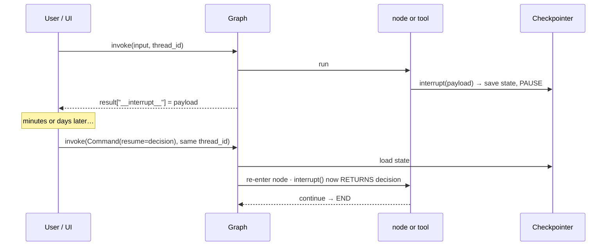

# 21 · Implement Human-in-the-Loop (HITL) in Agentic Chatbot using LangGraph

> **Video:** [17:50:27](https://www.youtube.com/watch?v=Zy7EXDONlTY&t=64227s) · **Code:** [`10_HITL.ipynb`](../../src/05-langgraph-workflows/10_HITL.ipynb) / [`notebooks/HITL_demo.ipynb`](../../src/06-agentic-chatbot/notebooks/HITL_demo.ipynb) · [`chatbot_without_hitl.py`](../../src/06-agentic-chatbot/chatbot_without_hitl.py) · [`chatbot_with_hitl.py`](../../src/06-agentic-chatbot/chatbot_with_hitl.py) · [`agentic_chatbot_hitl_backend.py`](../../src/06-agentic-chatbot/agentic_chatbot_hitl_backend.py) · [`app_hitl.py`](../../src/06-agentic-chatbot/app_hitl.py) · **Diagrams:** [`21-langgraph-hitl.excalidraw`](../diagrams/21-langgraph-hitl.excalidraw) · [`21-agentic-chatbot-hitl.excalidraw`](../diagrams/21-agentic-chatbot-hitl.excalidraw)

> [!IMPORTANT]
> **Human-in-the-loop (HITL)** is a design approach where a human takes part at **critical points** of an AI workflow, to supervise, approve, correct or guide it. Think of it as **human checkpoints in the pipeline**, so important decisions are not made autonomously.

## Why

| Reason | Example |
|---|---|
| Help the agent finish a task | Agent drafts a LinkedIn post, a human approves it, then it is published |
| Accountability | Asked for 20 shares, the agent could buy 40. A human checks first |
| Accuracy | Catches hallucinated or wrong actions |
| Safety | Money, deletions, sending email |
| Ethical alignment | Block abusive or sexual content before posting |
| Better UX | Clear *Approve / Reject* moments (Cursor, Antigravity, ChatGPT all do this) |

> [!TIP]
> Add HITL **only where it matters**. Web search and weather do not need approval; **buying stock does**.

### Common HITL patterns

| Pattern | Flow |
|---|---|
| **Action approval** | approve / reject *before* execution |
| **Output review & edit** | human edits the draft, then it is finalised |
| **Ambiguity clarification** | "Which Friday, this week or next?" |
| **Escalation** | bot hands off to a human owner when out of depth |

---

## How LangGraph does it: `interrupt` + `Command(resume=...)`



> [!IMPORTANT]
> **A checkpointer is mandatory.** The pause is a saved checkpoint, and resuming means loading it by `thread_id` and continuing **from that node** rather than from `START` ([14](14-persistence.md)).

## Lesson 01 · Minimal demo: approve before answering

```python
from langgraph.types import interrupt, Command

def chat_node(state: ChatState):
    decision = interrupt({
        "type": "approval",
        "reason": "Model is about to answer a user question.",
        "question": state["messages"][-1].content,
        "instruction": "Approve this question? yes/no",
    })
    if decision["approved"] == "no":
        return {"messages": [AIMessage(content="Not approved.")]}
    return {"messages": [llm.invoke(state["messages"])]}

app = builder.compile(checkpointer=MemorySaver())
config = {"configurable": {"thread_id": "1234"}}

result = app.invoke({"messages": [("user", "Explain gradient descent in very simple terms.")]}, config=config)
result["__interrupt__"][0].value                     # → the payload dict above

answer = input("Approve this question? (y/n): ")
final = app.invoke(Command(resume={"approved": answer}), config=config)
```

## Lesson 02 · The real case: a sensitive tool

**Without HITL** ([`chatbot_without_hitl.py`](../../src/06-agentic-chatbot/chatbot_without_hitl.py)): *"Purchase 10 stock of Apple"* is **executed immediately** with no confirmation.

**With HITL**, the interrupt goes **inside the tool**, not the chat node:

```python
@tool
def purchase_stock(symbol: str, quantity: int) -> dict:
    """Simulate purchasing a given quantity of a stock symbol.
    HUMAN-IN-THE-LOOP: interrupts and waits for a human decision before confirming."""
    decision = interrupt(f"Approve buying {quantity} shares of {symbol}? (yes/no)")
    if isinstance(decision, str) and decision.lower() == "yes":
        return {"status": "success", "message": f"Purchase order placed for {quantity} shares of {symbol}."}
    return {"status": "cancelled", "message": f"Purchase of {quantity} shares of {symbol} was declined by human."}

tools = [search_tool, calculator, get_stock_price, get_current_weather, rag_tool, purchase_stock]
# system prompt gains: "- Use `purchase_stock` when the user wants to purchase a stock."
```

> [!NOTE]
> The tool is a **simulation**. A real one would call a brokerage API after approval.

CLI loop:

```python
result = chatbot.invoke(state, config={"configurable": {"thread_id": "demo-thread"}})
interrupts = result.get("__interrupt__", [])
if interrupts:
    decision = input(f"HITL: {interrupts[0].value}\nYour decision: ").strip().lower()
    result = chatbot.invoke(Command(resume=decision), config={"configurable": {"thread_id": "demo-thread"}})
print("Bot:", result["messages"][-1].content)
```

| You | Bot |
|---|---|
| "Stock price of Apple?" | `get_stock_price` → price |
| "Purchase 20 stock of Apple" | ⏸ *Approve buying 20 shares of AAPL? (yes/no)* → **yes** → order placed |
| "Purchase 20 stock of Google" | ⏸ … → **no** → *request was declined* |

## Lesson 03 · Approve / Reject buttons in Streamlit

[`app_hitl.py`](../../src/06-agentic-chatbot/app_hitl.py) (UI generated with ChatGPT; backend unchanged) adds:

| Helper | Job |
|---|---|
| `get_pending_interrupt(thread_id)` | Read `chatbot.get_state(...)` → `.interrupts` (or `task.interrupts` on older versions) |
| `sync_pending_interrupt(thread_id)` | Re-show a pending approval after a rerun, refresh or thread switch, since it lives in the **checkpoint** |
| `resume_hitl_execution("yes" \| "no")` | `chatbot.stream(Command(resume=decision), config=same thread, run_name="hitl_resume_trace")` |

`reset_chat()` also clears `st.session_state["pending_hitl"]`.

> [!TIP]
> Because the pause is persisted in SQLite, you can **close the browser, come back tomorrow, open the thread, and the Approve / Reject card is still there**.

> [!NOTE]
> **Exercise:** add a second sensitive tool (send email, delete a Drive file, post to LinkedIn) and guard it with `interrupt()` in the same way.

## References

[1] `interrupt`, `Command`, patterns. Available in [LangGraph — Human-in-the-loop](https://langchain-ai.github.io/langgraph/concepts/human_in_the_loop/)

[2] Approve / edit / review tool calls. Available in [LangGraph — Add human-in-the-loop](https://langchain-ai.github.io/langgraph/how-tos/human_in_the_loop/add-human-in-the-loop/)
