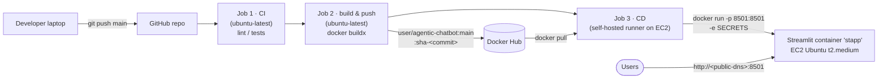

# 22 · Agentic Chatbot CI/CD Deployment on AWS with Docker & GitHub Actions

> **Video:** [18:48:09](https://www.youtube.com/watch?v=Zy7EXDONlTY&t=67689s) · **Code:** app = [`app_hitl.py`](../../src/06-agentic-chatbot/app_hitl.py) + [`agentic_chatbot_hitl_backend.py`](../../src/06-agentic-chatbot/agentic_chatbot_hitl_backend.py), renamed to `app.py` / `backend.py`. Deployment files live in the instructor's deploy repo [entbappy/Agentic-Chatbot-using-LangGraph](https://github.com/entbappy/Agentic-Chatbot-using-LangGraph) (`Dockerfile`, `.dockerignore`, `.github/workflows/cicd.yaml`)

## Why CI/CD

Manual deploy: stop the server, upload new code, restart. During the gap users see **server errors** and leave. ChatGPT ships updates daily without visible downtime.

> [!IMPORTANT]
> **CI/CD (Continuous Integration / Continuous Delivery-Deployment):** push to `main`, and an automated pipeline **tests, builds, ships and restarts** the app on the server. The developer never logs in to deploy.

| CI/CD tool | Setup |
|---|---|
| **GitHub Actions** | Built into GitHub, nothing to host (**used here**) |
| Jenkins | Self-hosted server |
| CircleCI | SaaS, separate account |

## Architecture



---

## Lesson 01 · Prepare the repo

1. New GitHub repo (README, Python `.gitignore`, Apache-2.0), cloned locally.
2. Copy **only the final files**: `app_hitl.py` → `app.py`, `agentic_chatbot_hitl_backend.py` → `backend.py`, `requirements.txt`, `.env` (local only). Fix the import in `app.py`.
3. `streamlit run app.py` locally to confirm, then **delete `chatbot.db`** so the server starts clean.

## Lesson 02 · Dockerfile

```dockerfile
FROM python:3.11-slim
ENV PYTHONDONTWRITEBYTECODE=1 PYTHONUNBUFFERED=1 PIP_NO_CACHE_DIR=1
WORKDIR /app

# build-essential: compile wheels · libgomp1: needed by faiss-cpu
RUN apt-get update && apt-get install -y --no-install-recommends build-essential libgomp1 \
    && rm -rf /var/lib/apt/lists/*

COPY requirements.txt .                         # copied first → layer cache
RUN python -m pip install --upgrade pip && pip install --no-cache-dir -r requirements.txt
COPY . .

EXPOSE 8501
CMD ["streamlit", "run", "app.py", "--server.port=8501", "--server.address=0.0.0.0",
     "--server.headless=true", "--browser.gatherUsageStats=false"]
```

`.dockerignore` keeps `venv/`, `.venv/`, `env/` … out of the image. It should also include `.env`, `*.db` and `faiss_db/`.

## Lesson 03 · `.github/workflows/cicd.yaml`

> [!NOTE]
> The folder names `.github/workflows/` are **mandatory**. The job that deploys must say `runs-on: self-hosted`, matching the runner name you register on EC2.

```yaml
name: Streamlit AWS CI/CD
on:
  push:
    branches: [main]
    paths-ignore: ["README.md"]          # README edits don't redeploy
  workflow_dispatch:
concurrency: { group: agentic-chatbot-production, cancel-in-progress: true }
permissions: { contents: read }

jobs:
  integration:                           # 1 · CI (placeholders for lint / tests)
    runs-on: ubuntu-latest
    steps: [ { uses: actions/checkout@v4 }, { run: echo "Linting repository" }, { run: echo "Running unit tests" } ]

  push_to_registry:                      # 2 · build & push
    needs: integration
    runs-on: ubuntu-latest
    steps:
      - uses: actions/checkout@v4
      - uses: docker/setup-buildx-action@v3
      - uses: docker/login-action@v4
        with: { username: "${{ secrets.DOCKER_USERNAME }}", password: "${{ secrets.DOCKER_PASSWORD }}" }
      - uses: docker/build-push-action@v6
        with:
          push: true
          tags: |
            ${{ secrets.DOCKER_USERNAME }}/${{ secrets.IMAGE_NAME }}:main
            ${{ secrets.DOCKER_USERNAME }}/${{ secrets.IMAGE_NAME }}:sha-${{ github.sha }}
          cache-from: type=gha
          cache-to: type=gha,mode=max

  continuous_deployment:                 # 3 · CD on EC2
    needs: push_to_registry
    runs-on: self-hosted
    steps:
      - # login · validate required secrets · docker pull <image>:main
      - run: docker rm -f stapp 2>/dev/null || true
      - run: |
          docker run -d --restart unless-stopped --name stapp -p 8501:8501 \
            -e OPENAI_API_KEY -e GOOGLE_API_KEY -e TAVILY_API_KEY -e OPENWEATHER_API_KEY \
            -e LANGSMITH_TRACING -e LANGSMITH_ENDPOINT -e LANGSMITH_API_KEY -e LANGSMITH_PROJECT \
            "${IMAGE_PATH}:main"
      - # verify container running · poll http://localhost:8501/_stcore/health · logs · docker image prune -f
```

> [!WARNING]
> In this repo `get_stock_price` reads **`ALPHAVANTAGE_API_KEY`**. Add it to the secrets **and** to the `-e` list, otherwise the stock tool will fail in production.

## Lesson 04 · AWS

| Step | Detail |
|---|---|
| 1 · IAM user | e.g. `agentic-user`, policy **AmazonEC2FullAccess** only (least privilege). *Security credentials → Create access key → CLI*, then download the CSV |
| 2 · EC2 | Ubuntu, **t2.medium** (2 vCPU / 4 GB), key pair, allow HTTP + HTTPS, **32 GB** disk |
| 3 · Connect | *EC2 Instance Connect* (browser terminal) |
| 4 · Docker | `sudo apt-get update -y && sudo apt-get upgrade` · `curl -fsSL https://get.docker.com -o get-docker.sh && sudo sh get-docker.sh` · `sudo usermod -aG docker ubuntu && newgrp docker` |
| 5 · Runner | GitHub *Settings → Actions → Runners → New self-hosted runner → Linux*. Run the commands on EC2. **Runner name: `self-hosted`**, then `./run.sh` until it says *Listening for Jobs* |
| 6 · Port | *Security group → Edit inbound rules → Custom TCP 8501, source 0.0.0.0/0* |

## Lesson 05 · GitHub secrets

*Settings → Secrets and variables → Actions → New repository secret*:

```text
REGISTRY=docker.io                 DOCKER_USERNAME=<hub user>      DOCKER_PASSWORD=<hub access token>
IMAGE_NAME=agentic-chatbot         AWS_ACCESS_KEY_ID=…             AWS_SECRET_ACCESS_KEY=…
AWS_REGION=us-east-1               OPENAI_API_KEY=… (optional)     GOOGLE_API_KEY=…
TAVILY_API_KEY=…                   OPENWEATHER_API_KEY=…           ALPHAVANTAGE_API_KEY=…
LANGSMITH_TRACING=true             LANGSMITH_ENDPOINT=https://api.smith.langchain.com
LANGSMITH_API_KEY=…                LANGSMITH_PROJECT=agentic-chatbot-project
```

> [!TIP]
> Use a Docker Hub **access token**, not your account password, for `DOCKER_PASSWORD`.

## Lesson 06 · Ship, then ship again

1. `git push origin main` → *Actions* tab: CI ✅ → build & push ✅ (image appears on Docker Hub) → deploy ✅.
2. Open `http://<EC2-public-DNS>:8501`. Test chat, weather, news, stock price, **HITL purchase**, PDF upload (RAG), new thread.
3. Change the title to `🤖 Agentic Chatbot…`, then commit and push. The pipeline reruns and **the site stays up the whole time**. Refresh to see the update.

## Teardown (avoid charges)

*EC2 → Instance state → Terminate*, delete the IAM user (deactivate keys first), and optionally delete the Docker Hub image.

## References

[1] Workflow syntax and self-hosted runners. Available in [GitHub Actions docs](https://docs.github.com/actions)

[2] Build / push actions. Available in [docker/build-push-action](https://github.com/docker/build-push-action)

[3] Instance types, security groups. Available in [Amazon EC2 docs](https://docs.aws.amazon.com/ec2/)
