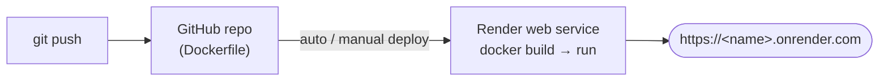

# 23 · Deploy Agentic AI Chatbot on Render for FREE with Docker

> **Video:** [19:52:05](https://www.youtube.com/watch?v=Zy7EXDONlTY&t=71525s) · **Code:** same repo and `Dockerfile` as [22](22-cicd-deployment-aws.md) ([entbappy/Agentic-Chatbot-using-LangGraph](https://github.com/entbappy/Agentic-Chatbot-using-LangGraph))

## Why Render

**Render** is a managed cloud for web apps: a few clicks, **built-in CI/CD**, and a **free instance** (512 MB RAM, 0.1 CPU). It is slow but enough to put a learning project online. Paid plans are for production.

| | AWS EC2 ([22](22-cicd-deployment-aws.md)) | Render |
|---|---|---|
| Server setup | IAM, EC2, Docker install, security group | None |
| CI/CD | Write `cicd.yaml` + self-hosted runner | Built in, triggered from the connected repo |
| Image registry | Docker Hub | Render builds from your `Dockerfile` (or pulls an existing image) |
| Cost | Pay per instance-hour | Free tier available |

## Steps

1. Sign in at **render.com** (Google).
2. **New → Web Service → Public Git repository**, paste the repo URL, then **Connect**. *(Alternative: deploy an existing Docker Hub image.)*
3. **Language: Docker** (Render uses the repo's `Dockerfile`). Leave the other settings at their defaults.
4. **Instance type: Free**.
5. **Environment variables**: `TAVILY_API_KEY`, `OPENWEATHER_API_KEY`, `ALPHAVANTAGE_API_KEY`, `GOOGLE_API_KEY` (or `OPENAI_API_KEY`), `LANGSMITH_TRACING`, `LANGSMITH_ENDPOINT`, `LANGSMITH_API_KEY`, `LANGSMITH_PROJECT`. You can also upload a `.env`.
6. **Deploy Web Service**. Wait for the Docker build until the status is **Live**, then open the URL.

### Smoke test

| Prompt | Result |
|---|---|
| "Hi" | greeting |
| "Current weather in Bengaluru" | `get_current_weather` ✅ |
| "Latest FIFA score today" | `tavily_search` ✅ |
| "Stock price of Google" | ❌ Alpha Vantage free **rate limit** hit, so create a new key |
| Upload résumé + "Who is …?" | `rag_tool` ✅ |
| New Chat → "Hi, I am Alex" | new thread ✅ |

> [!WARNING]
> On the free tier the container's filesystem is **ephemeral**. `chatbot.db` (threads) and `faiss_db/` (RAG index) are wiped on every redeploy or restart, and free services also **spin down when idle**. For persistent memory, point the checkpointer at a managed Postgres (`PostgresSaver`).

## Redeploy (CI/CD)

1. Edit the code (here: remove the 🤖 emoji from the title), then commit and push.
2. Render → **Events → Manual Deploy → Deploy latest commit**, or turn on **Auto-Deploy** in Settings so every push to `main` deploys.
3. The old version keeps serving until the new one is live, so there is **no downtime**.

## Teardown

*Settings → Delete Web Service*, type the confirmation command, then delete.

## References

[1] Docker-based web services. Available in [Render docs — Docker](https://render.com/docs/docker)

[2] Free instance limits. Available in [Render docs — Free instances](https://render.com/docs/free)
