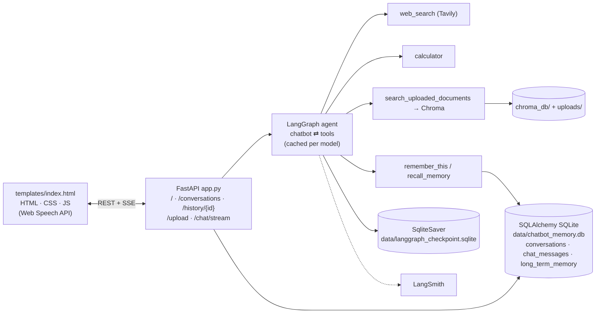

# 24 · Project: Build Your Own ChatGPT Agent (BappyGPT)

> **Video:** [20:06:27](https://www.youtube.com/watch?v=Zy7EXDONlTY&t=72387s) · **Code:** separate repo [entbappy/BappyGPT](https://github.com/entbappy/BappyGPT) (not part of the course repository, so not copied into `src/`) · **Stack:** Gemini · LangGraph · FastAPI · LangSmith · ChromaDB · SQLAlchemy + SQLite · Docker · GitHub Actions · AWS ECR + EC2

## Project overview

A **ChatGPT clone** that reuses everything from [13](13-first-agentic-chatbot.md)–[22](22-cicd-deployment-aws.md), now with a **FastAPI backend**, an **HTML/CSS/JS frontend**, **long-term memory** and **voice input**:

| Feature | How |
|---|---|
| Threads sidebar, new chat, resume | `thread_id` + SQLAlchemy `conversations` table (title = first 40 chars) |
| Model picker | Gemini 2.5 Flash / Pro …, validated server-side |
| Token streaming | FastAPI `StreamingResponse` (SSE) from `agent.stream(...)` |
| PDF / DOCX / TXT / MD / PY / CSV upload → Q&A | Chroma + `gemini-embedding-001` (RAG tool) |
| Web search | `TavilySearch` |
| Calculator | `@tool` |
| **Long-term memory**: "remember my favourite colour is red" | `remember_this` / `recall_memory` tools → SQLAlchemy `long_term_memory` table |
| Voice mode | Browser **Web Speech API** (`SpeechRecognition`) in JavaScript, so no Python audio code |
| Tracing | LangSmith project `bappygpt` |

> [!NOTE]
> **Gemini instead of OpenAI** keeps the project free to run. Any `ChatXxx` provider can be swapped in. User accounts / login were left out on purpose.

## Architecture



### Two databases, two jobs

| Store | Holds | Used for |
|---|---|---|
| `SqliteSaver` checkpoint DB | Graph **state** per thread | Short-term memory, resume |
| SQLAlchemy DB | `conversations` (titles), `chat_messages` (UI history), `long_term_memory` (facts) | Sidebar, history view, **cross-thread recall** |

---

## Lesson 01 · Setup

```bash
conda create -n bappygpt python=3.11 -y && conda activate bappygpt
pip install -r requirements.txt
# fastapi uvicorn jinja2 python-multipart python-dotenv langchain langchain-google-genai langchain-core
# langgraph langchain-text-splitters langgraph-checkpoint-sqlite langchain-chroma chromadb pypdf
# langchain-tavily tavily-python sqlalchemy (+ docx2txt)
```

`.env`: `GOOGLE_API_KEY`, `GOOGLE_MODEL=gemini-2.5-flash`, `TAVILY_API_KEY`, `LANGSMITH_TRACING/ENDPOINT/API_KEY/PROJECT=bappygpt`.

Layout: `agent.py` · `tools.py` · `rag.py` · `database.py` · `app.py` · `templates/index.html`.

> [!TIP]
> On Windows, set `SSL_CERT_FILE` / `REQUESTS_CA_BUNDLE` to `certifi.where()` at import time to avoid certificate-path errors.

## Lesson 02 · `agent.py`

```python
ALLOWED_MODELS = {...}; DEFAULT_MODEL = os.getenv("GOOGLE_MODEL", "gemini-2.5-flash")

def normalize_model_name(name):                      # never trust the model id from the browser
    name = (name or "").strip()
    return name if name in ALLOWED_MODELS else DEFAULT_MODEL

def build_agent(model_name):
    llm = ChatGoogleGenerativeAI(model=normalize_model_name(model_name), temperature=..., streaming=True)
    llm_with_tools = llm.bind_tools(tools)
    def chatbot(state: MessagesState):                # prebuilt MessagesState
        return {"messages": [llm_with_tools.invoke([SystemMessage(SYSTEM_PROMPT), *state["messages"]])]}
    g = StateGraph(MessagesState)
    g.add_node("chatbot", chatbot); g.add_node("tools", ToolNode(tools))
    g.add_edge(START, "chatbot"); g.add_conditional_edges("chatbot", tools_condition); g.add_edge("tools", "chatbot")
    conn = sqlite3.connect("data/langgraph_checkpoint.sqlite", check_same_thread=False)
    return g.compile(checkpointer=SqliteSaver(conn))

_agent_cache = {}
def get_agent(model_name):                           # build once per model, reuse
    m = normalize_model_name(model_name)
    if m not in _agent_cache:
        _agent_cache[m] = build_agent(m)
    return _agent_cache[m]
```

System prompt: *"You are BappyGPT, similar to ChatGPT… search uploaded documents, search the web for current info, remember / recall user facts, use the calculator for math…"*

## Lesson 03 · `rag.py`

* `read_file_text(path)`: PDF via `PdfReader`, DOCX via `docx2txt`, `.txt/.md/.py/.csv` read as text, anything else rejected.
* `add_document_to_rag(path, thread_id)`: split with `RecursiveCharacterTextSplitter`, then `Chroma(collection_name="agentic_chatbot_docs", persist_directory="chroma_db", embedding_function=GoogleGenerativeAIEmbeddings("models/gemini-embedding-001"))`.
* `retrieve_from_rag(query, thread_id, k=4)` → `similarity_search` → joined text.

## Lesson 04 · `database.py` and `tools.py`

SQLAlchemy ORM over `sqlite:///data/chatbot_memory.db` with three tables, plus helpers `init_db`, `create_or_update_conversation`, `list_conversations`, `save_chat_message`, `get_chat_history`, `save_memory`, `search_memory`.

```python
@tool
def remember_this(memory: str) -> str:
    """Save an important fact about the user to long-term memory."""
    return save_memory(CURRENT_THREAD_ID, memory)

@tool
def recall_memory(query: str) -> str:
    """Search long-term memory for facts the user shared earlier."""
    return search_memory(query)

@tool
def search_uploaded_documents(query: str) -> str:
    """Search the user's uploaded documents."""
    return retrieve_from_rag(query, CURRENT_THREAD_ID)

tools = [calculator, search_uploaded_documents, remember_this, recall_memory, web_search]
```

> [!NOTE]
> Long-term memory ≠ checkpoint memory. *"My name is Bappy, remember that"* writes a row in `long_term_memory`, so `recall_memory` can find it **from any thread**.

## Lesson 05 · `app.py` (FastAPI)

| Route | Does |
|---|---|
| `GET /` | Render `templates/index.html` (Jinja2) |
| `GET /conversations` | `list_conversations()` for the sidebar |
| `GET /history/{thread_id}` | `get_chat_history()` to reload a thread |
| `POST /upload` | Save to `uploads/`, `add_document_to_rag`, log a message |
| `POST /chat/stream` | Save the user message, `set_current_thread_id`, `agent.stream(..., stream_mode="messages")`, **filter out `ToolMessage`**, yield `AIMessageChunk` text as SSE |

```python
@app.post("/chat/stream")
async def chat_stream(...):
    agent = get_agent(selected_model)
    async def event_generator():
        for chunk, meta in agent.stream({"messages": [HumanMessage(content=msg)]}, config, stream_mode="messages"):
            if should_stream_chunk(chunk):
                yield sse_data(extract_text_from_chunk(chunk))
    return StreamingResponse(event_generator(), media_type="text/event-stream")

if __name__ == "__main__":
    uvicorn.run("app:app", host="0.0.0.0", port=8080, reload=True)
```

> [!TIP]
> Routes are `async def` so FastAPI serves many users concurrently ([03](03-asynchronous-programming.md)).

## Lesson 06 · CI/CD to AWS (ECR variant)

Same flow as [22](22-cicd-deployment-aws.md), but the image goes to **Amazon ECR** instead of Docker Hub:

| Difference | Here |
|---|---|
| IAM policies | `AmazonEC2ContainerRegistryFullAccess` + `AmazonEC2FullAccess` |
| Registry | ECR repo `bappygpt`; secret `ECR_REPO` |
| Instance | Ubuntu, **8 GB RAM** / 2 vCPU |
| Port | **8080** (inbound rule) |
| Dockerfile | `python:3.11`, `mkdir uploads data`, `EXPOSE 8080`, `CMD uvicorn app:app --host 0.0.0.0 --port 8080` |
| Secrets | `GOOGLE_API_KEY`, `GOOGLE_MODEL`, `TAVILY_API_KEY`, `LANGSMITH_*`, `AWS_ACCESS_KEY_ID`, `AWS_SECRET_ACCESS_KEY`, `AWS_REGION`, `ECR_REPO` |

Push to `main`: CI (configure AWS creds → ECR login → build → push), then CD on the self-hosted EC2 runner (pull → run). The app is served at `http://<public-dns>:8080`. Teardown: terminate EC2, delete the ECR repo, delete the IAM user. A free alternative is Render ([23](23-deployment-render.md)).

> [!WARNING]
> The demo committed its SQLite DBs to GitHub, so old threads appeared on the server. **Don't.** Those files contain chat history; keep them git-ignored and use a managed DB for shared state.

> [!NOTE]
> **Exercise:** add the weather and stock tools from [19](19-tool-integration.md), plus HITL for any action tool ([21](21-human-in-the-loop.md)).

## References

[1] Source code. Available in [entbappy/BappyGPT](https://github.com/entbappy/BappyGPT)

[2] Streaming responses. Available in [FastAPI — StreamingResponse](https://fastapi.tiangolo.com/advanced/custom-response/#streamingresponse)

[3] ORM basics. Available in [SQLAlchemy 2.0 tutorial](https://docs.sqlalchemy.org/en/20/tutorial/)

[4] Vector store. Available in [LangChain — Chroma](https://python.langchain.com/docs/integrations/vectorstores/chroma/)

[5] Browser speech-to-text. Available in [MDN — Web Speech API](https://developer.mozilla.org/en-US/docs/Web/API/Web_Speech_API)
