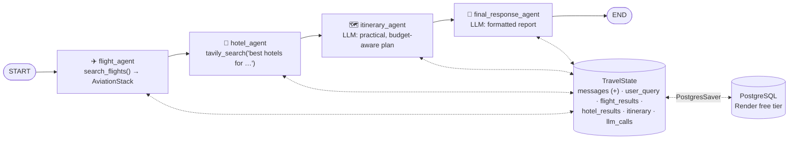

# 25 · Project: TripMate AI — Multi-Agent Travel Planner

> **Video:** [22:21:17](https://www.youtube.com/watch?v=Zy7EXDONlTY&t=80477s) · **Code:** separate repo [entbappy/TripMate-AI-A-Multi-Agent-Travel-Planner-with-LangGraph](https://github.com/entbappy/TripMate-AI-A-Multi-Agent-Travel-Planner-with-LangGraph) (not part of the course repository, so not copied into `src/`) · **Stack:** Groq (Llama 3.3 70B) · LangGraph · Tavily · AviationStack · PostgreSQL on Render · FastAPI + HTML/CSS/JS · LangSmith · Docker · Render

## Project overview

Type one sentence, *"Plan a complete 7-day Nepal trip from Bangladesh under 2 lakh"*, and get a full plan: **flights, hotels, day-by-day itinerary, estimated budget, recommendations**, downloadable as a PDF. It replaces hopping between flight sites, hotel reviews and spreadsheets.

> [!IMPORTANT]
> This is the course's **multi-agent** LangGraph project. Four specialised agents share one state, in contrast to the single tool-calling chatbot in BappyGPT ([24](24-project-bappygpt.md)).



| Agent | Tool / model | Writes |
|---|---|---|
| Flight | `search_flights` (AviationStack API + `airportsdata` + `pycountry`) | `flight_results` |
| Hotel | `tavily_search` (Google Places optional) | `hotel_results` |
| Itinerary | LLM (*"expert travel planner"*) | `itinerary` |
| Final response | LLM (*"professional AI travel booking assistant"*) | `messages` (final report) |

> [!NOTE]
> The agents call tools **directly inside the node**, not via `bind_tools` / `ToolNode`. Each step is fixed, so there is no need to let the LLM decide, and this saves LLM calls. That makes it a **sequential multi-agent workflow** ([09](09-sequential-workflows.md)).

---

## Lesson 01 · Setup

```bash
conda create -n travel python=3.11 -y && conda activate travel
pip install -r requirements.txt
# langgraph langchain langchain-groq langchain-community langchain-tavily tavily-python
# psycopg[binary] psycopg-pool langgraph-checkpoint-postgres python-dotenv requests
# airportsdata pycountry fastapi uvicorn jinja2
```

```dotenv
GROQ_API_KEY=...
AVIATIONSTACK_API_KEY=...
DEFAULT_ORIGIN=DAC              # used when the user doesn't say where they start
TAVILY_API_KEY=...
DATABASE_URL=postgresql://...   # Render EXTERNAL url for local dev, no quotes
LANGSMITH_TRACING=true
LANGSMITH_ENDPOINT=https://api.smith.langchain.com
LANGSMITH_API_KEY=...
LANGSMITH_PROJECT=tripmate-ai
```

Layout: `tools/{tavily_tool,flight_tools}.py` · `backend.py` · `app.py` · `templates/index.html` · `static/{style.css,script.js}` · `Dockerfile` · `.dockerignore`.

## Lesson 02 · PostgreSQL on Render + pgAdmin

1. Render → **New → PostgreSQL**: name, DB name, user, region, **Free** (256 MB RAM, 1 GB disk; free DBs expire after a while).
2. Copy the **External Database URL** for local development. Deployed Render services use the **Internal Database URL**.
3. Install **PostgreSQL / pgAdmin**, then *Register → Server* with host, port `5432`, database, user, password from the URL. Tables appear after the first run (`checkpoints`, `checkpoint_writes`, …).

```python
def get_database_url():
    url = os.getenv("DATABASE_URL")
    if not url:
        raise ValueError("DATABASE_URL is missing")
    if "sslmode" not in url:
        url += ("&" if "?" in url else "?") + "sslmode=require"    # remote Postgres needs SSL
    return url
```

## Lesson 03 · Tools

```python
client = TavilyClient(api_key=os.getenv("TAVILY_API_KEY"))

def tavily_search(query):
    res = client.search(query=query, max_results=5)
    return [{"title": r["title"], "url": r["url"], "snippet": r["content"][:300]}   # trim to save tokens
            for r in res["results"]]
```

`search_flights(query, limit=10)` turns free text into IATA codes using **country aliases** (*US, UK, Korea…*), a **main-airport map** per country / city, `pycountry` and `airportsdata`, falling back to `DEFAULT_ORIGIN`. It then calls `http://api.aviationstack.com/v1/flights` and returns airline, flight number, status, departure / arrival, terminal, gate and schedule.

> [!TIP]
> Most of the airport-resolution code was generated with ChatGPT for **robustness**: users type country names, city names, abbreviations and typos. A naive single API call returns nothing for half of those inputs.

## Lesson 04 · `backend.py`: the graph

```python
llm = ChatGroq(model="llama-3.3-70b-versatile", api_key=GROQ_API_KEY)

class TravelState(TypedDict):
    messages: Annotated[list[AnyMessage], operator.add]
    user_query: str
    flight_results: list
    hotel_results: list
    itinerary: str
    llm_calls: int

def flight_agent(state):
    return {"flight_results": search_flights(state["user_query"]),
            "messages": [AIMessage(content="Flight results fetched.")],
            "llm_calls": state.get("llm_calls", 0) + 1}

def hotel_agent(state):
    return {"hotel_results": tavily_search(f"best hotels for {state['user_query']}"), ...}

def itinerary_agent(state):
    prompt = f"Create a complete travel itinerary.\nUser query: ...\nFlights: ...\nHotels: ...\n" \
             "Make the itinerary practical, budget-aware and easy to follow."
    return {"itinerary": llm.invoke([SystemMessage("You are an expert travel planner."),
                                     HumanMessage(prompt)]).content, ...}

def final_response_agent(state):
    # sections: Trip Summary · Flight Information · Hotel Suggestions · Day-by-Day Itinerary ·
    #           Estimated Budget · Final Recommendation · Important Notes
    ...

g = StateGraph(TravelState)
for n, f in [("flight_agent", flight_agent), ("hotel_agent", hotel_agent),
             ("itinerary_agent", itinerary_agent), ("final_response_agent", final_response_agent)]:
    g.add_node(n, f)
g.add_edge(START, "flight_agent"); g.add_edge("flight_agent", "hotel_agent")
g.add_edge("hotel_agent", "itinerary_agent"); g.add_edge("itinerary_agent", "final_response_agent")
g.add_edge("final_response_agent", END)

conn = psycopg.connect(get_database_url(), autocommit=True, row_factory=dict_row)
checkpointer = PostgresSaver(conn); checkpointer.setup()           # creates tables on first run
travel_graph = g.compile(checkpointer=checkpointer)

def run_travel_agent(user_input, thread_id=None):
    thread_id = thread_id or str(uuid.uuid4())
    result = travel_graph.invoke(
        {"messages": [HumanMessage(user_input)], "user_query": user_input,
         "flight_results": [], "hotel_results": [], "itinerary": "", "llm_calls": 0},
        {"configurable": {"thread_id": thread_id}})
    return {"thread_id": thread_id, "answer": result["messages"][-1].content, ...}
```

> [!TIP]
> `llm_calls` in state is a cheap **cost counter**: every agent increments it, and LangSmith shows the same numbers per trace.

## Lesson 05 · FastAPI + frontend

```python
app = FastAPI(title="TripMate AI", description="LangGraph multi-agent travel planner")
app.mount("/static", StaticFiles(directory=BASE_DIR / "static"), name="static")
templates = Jinja2Templates(directory=BASE_DIR / "templates")

class TravelRequest(BaseModel):
    message: str
    thread_id: str | None = None

@app.get("/", response_class=HTMLResponse)
async def home(request: Request): return templates.TemplateResponse("index.html", {"request": request})

@app.post("/api/travel")
async def travel_planner(req: TravelRequest):
    if not req.message.strip():
        return JSONResponse({"error": "Message cannot be empty"}, status_code=400)
    return run_travel_agent(req.message, req.thread_id)

@app.get("/health")
async def health(): return {"status": "ok"}

if __name__ == "__main__":
    uvicorn.run("app:app", host="0.0.0.0", port=8000, reload=True)
```

The ChatGPT-generated UI has an input box, example prompts, a rendered markdown plan, **Download PDF** and **Copy**.

## Lesson 06 · Deploy on Render

1. `Dockerfile` (`python:3.11`, install requirements, `EXPOSE 8000`, `CMD uvicorn app:app --host 0.0.0.0 --port 8000`) and `.dockerignore`.
2. Render → **New Web Service** → repo → Docker → Free. Paste the `.env` values, but **swap `DATABASE_URL` to the internal URL**.
3. Deploy, open the URL and test *"7-day India trip from Bangladesh"*.

AWS CI/CD works exactly as in [22](22-cicd-deployment-aws.md).

---

## Where the course goes next

The instructor's follow-up phases (on the DSwithBappy channel, not in this video): **CrewAI**, **Microsoft AutoGen**, **n8n** (no-code), **MCP (Model Context Protocol)**, and **AI safety & evaluation** (guardrails, prompt injection, tool restrictions). The upstream code repo already includes early material on **subgraphs, guardrails, agent evaluation, LLM gateways** and **advanced RAG**. See [`src/05-langgraph-workflows/`](../../src/05-langgraph-workflows/) and [`src/07-advanced-rag/`](../../src/07-advanced-rag/).

## References

[1] Source code. Available in [entbappy/TripMate-AI](https://github.com/entbappy/TripMate-AI-A-Multi-Agent-Travel-Planner-with-LangGraph)

[2] Postgres checkpointer. Available in [langgraph-checkpoint-postgres](https://pypi.org/project/langgraph-checkpoint-postgres/)

[3] LLM provider. Available in [Groq — models](https://console.groq.com/docs/models)

[4] Flight data API. Available in [AviationStack](https://aviationstack.com/documentation)

[5] Managed Postgres. Available in [Render — PostgreSQL](https://render.com/docs/postgresql)
