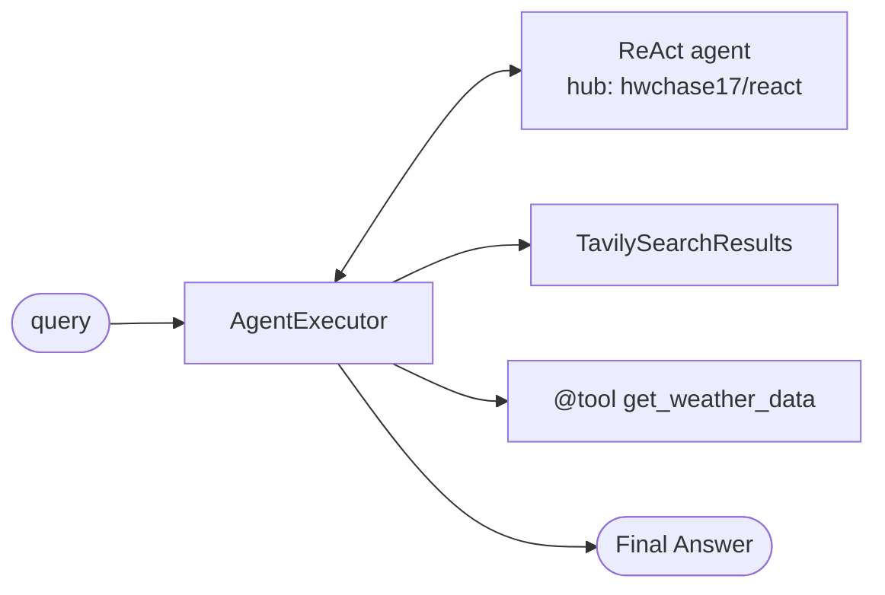

# 03 · LangChain Single Agent: Search + Weather

> **Notes:** [05 · Building an End-to-End Single AI Agent with LangChain](../../docs/notes/05-langchain-single-agent.md)

A ReAct agent (`gpt-3.5-turbo`) with **Tavily search** and a custom **Weatherstack** tool, built on the **legacy** `create_react_agent` + `AgentExecutor` API.



| File | Purpose |
|---|---|
| [`research/agent_demo.ipynb`](research/agent_demo.ipynb) | Step-by-step build and experiments |
| [`main.py`](main.py) | CLI run: *"Find the capital of India and then find its current weather."* |
| [`app.py`](app.py) | Streamlit UI |

```bash
conda create -n langagent python=3.11 -y && conda activate langagent
pip install -r requirements.txt        # pinned LangChain 0.1.x: keep this env separate from later modules
cp .env.example .env                   # OPENAI_API_KEY, TAVILY_API_KEY, WEATHERSTACK_API_KEY
python main.py
streamlit run app.py
```

> [!TIP]
> On Windows, `os.environ["SSL_CERT_FILE"] = certifi.where()` (already in the code) fixes certificate-path errors.
