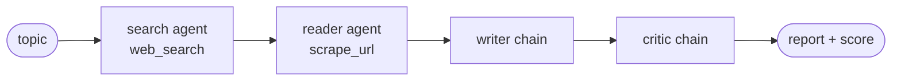

# 04 · LangChain Multi-Agent Research System

> **Notes:** [06 · Building an End-to-End Multi-Agent AI System with LangChain](../../docs/notes/06-langchain-multi-agent.md) · **Diagram:** [`06-multi-agent-research-system.excalidraw`](../../docs/diagrams/06-multi-agent-research-system.excalidraw)

Four specialists share a state dict: **search agent → reader agent → writer chain → critic chain**. The result is a structured research report with a reviewer score.



| Path | Contents |
|---|---|
| [`src/tools/tools.py`](src/tools/tools.py) | `web_search` (TavilyClient, top 5 → title / URL / 300-char snippet), `scrape_url` (trafilatura → readability → BeautifulSoup fallback, 5k-char cap) |
| [`src/agents/agents.py`](src/agents/agents.py) | `create_agent` search / reader agents (`gpt-4o-mini`), LCEL `writer_chain` and `critic_chain` |
| [`src/pipelines/pipeline.py`](src/pipelines/pipeline.py) | `run_research_pipeline(topic) → state` |
| [`main.py`](main.py) | CLI run |
| [`app.py`](app.py) | Streamlit UI with stage status, expanders, Markdown download |

```bash
conda create -n langagent-multi python=3.11 -y && conda activate langagent-multi
pip install -r requirements.txt
cp .env.example .env                   # OPENAI_API_KEY, TAVILY_API_KEY
python main.py
streamlit run app.py
```

> [!NOTE]
> `create_agent` is the LangChain **1.x** API. If `requirements.txt` resolves to an older release, upgrade with `pip install -U langchain langchain-openai`. This sub-project ships with its own upstream [`LICENSE`](LICENSE) (Apache-2.0).
