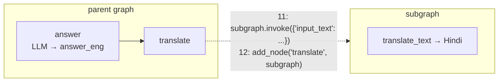

# 05 · LangGraph Workflows

> **Notes:** [07](../../docs/notes/07-langchain-vs-langgraph.md) · [08](../../docs/notes/08-langgraph-core-components.md) · [09](../../docs/notes/09-sequential-workflows.md) · [10](../../docs/notes/10-parallel-workflows.md) · [11](../../docs/notes/11-conditional-workflows.md) · [12](../../docs/notes/12-iterative-workflows.md) · [14](../../docs/notes/14-persistence.md) · [21](../../docs/notes/21-human-in-the-loop.md) · **Diagrams:** [`08-12-langgraph-workflows`](../../docs/diagrams/08-12-langgraph-workflows.excalidraw) · [`14-langgraph-persistence`](../../docs/diagrams/14-langgraph-persistence.excalidraw) · [`21-langgraph-hitl`](../../docs/diagrams/21-langgraph-hitl.excalidraw) · [`extra-langgraph-subgraphs`](../../docs/diagrams/extra-langgraph-subgraphs.excalidraw)

One notebook per LangGraph concept, from a four-line graph up to guardrails and evaluation.

## Notebook map

| # | Notebook | Pattern | LLM | Note |
|---|---|---|---|---|
| 1 | [`1_Temperature_Conversion_workflow`](1_Temperature_Conversion_workflow.ipynb) | Sequential | — | [09](../../docs/notes/09-sequential-workflows.md) |
| 2 | [`2_Simple_QA_LLM_Workflow`](2_Simple_QA_LLM_Workflow.ipynb) | Sequential, single LLM call | OpenAI | [09](../../docs/notes/09-sequential-workflows.md) |
| 3 | [`3_Prompt_Chaining_Workflow`](3_Prompt_Chaining_Workflow.ipynb) | Prompt chaining (outline → blog) | OpenAI | [09](../../docs/notes/09-sequential-workflows.md) |
| 4 | [`4_Employee_analytics_Workflow`](4_Employee_analytics_Workflow.ipynb) | Parallel fan-out / fan-in | — | [10](../../docs/notes/10-parallel-workflows.md) |
| 5 | [`5_Essay_workflow`](5_Essay_workflow.ipynb) | Parallel + **reducer** + structured output | OpenAI | [10](../../docs/notes/10-parallel-workflows.md) |
| 6 | [`6_Content_Moderation_Workflow`](6_Content_Moderation_Workflow.ipynb) | Conditional routing | — | [11](../../docs/notes/11-conditional-workflows.md) |
| 7 | [`7_Review_workflow`](7_Review_workflow.ipynb) | Conditional + Pydantic diagnosis | OpenAI | [11](../../docs/notes/11-conditional-workflows.md) |
| 8 | [`8_Iterative_Workflows`](8_Iterative_Workflows.ipynb) | Evaluator–optimizer loop | OpenAI | [12](../../docs/notes/12-iterative-workflows.md) |
| 9 | [`9_Persistence`](9_Persistence.ipynb) | Checkpointer, threads, fault tolerance, time travel | Gemini | [14](../../docs/notes/14-persistence.md) |
| 10 | [`10_HITL`](10_HITL.ipynb) | `interrupt` / `Command(resume=…)` | Gemini | [21](../../docs/notes/21-human-in-the-loop.md) |
| 11 | [`11_subgraphs`](11_subgraphs.ipynb) | Subgraph **called inside a node** (different state) | Gemini | below |
| 12 | [`12_subgraph_shared`](12_subgraph_shared.ipynb) | Subgraph **added as a node** (shared state) | Gemini | below |
| 13 | [`13_guardrails_crash_course`](13_guardrails_crash_course.ipynb) | Guardrails with LangChain agent middleware | Groq | below |
| — | [`AI_Agent_Evaluation`](AI_Agent_Evaluation.ipynb) | Five-dimension agent evaluation | Groq | below |
| — | [`llm_gateway`](llm_gateway.ipynb) | LiteLLM gateway: fallbacks, cost, cache, routing | multi | below |

```bash
conda create -n langgraph-test python=3.11 -y && conda activate langgraph-test
pip install -r requirements.txt
cp .env.example .env     # OPENAI / GROQ / GOOGLE / ANTHROPIC keys as needed; LangSmith optional
```

> [!TIP]
> Out of OpenAI credit? Notebooks 9–12 already use Gemini (`ChatGoogleGenerativeAI(model="gemini-2.5-flash")`). Swap the same line into the others.

---

## Beyond the video: extra lessons in this folder

### Subgraphs (nested workflows)

Translate an English answer into Hindi with a reusable subgraph.



| | `11_subgraphs` | `12_subgraph_shared` |
|---|---|---|
| State | `SubState` ≠ `ParentState` | Same `ParentState` |
| Wiring | A parent node **calls** `subgraph.invoke(...)` and maps keys in and out | The compiled subgraph **is** the node |
| Use when | Isolated components with their own schema | Sub-steps that read and write the same state |

### Guardrails crash course

Safety controls around an agent, built with LangChain 1.x **agent middleware** (`create_agent(..., middleware=[...])`):

| Layer | Hook | Example |
|---|---|---|
| Deterministic vs model-based | — | Regex / keywords (fast, cheap) vs an LLM judge (nuanced, costs tokens) |
| `PIIMiddleware` | Around model calls | `email` → `redact`, `credit_card` → `mask`, custom `api_key` regex `sk-…` → `block` |
| `HumanInTheLoopMiddleware` | Before tools | `interrupt_on={"send_email": True, "delete_records": True, "search_web": False}`, resumed with `Command(resume={"decisions":[{"type":"approve"}]})` or `reject` + reason |
| Custom `before_agent` | Input filter | `ContentFilterMiddleware` blocks *"hack into a server"* and jumps to `end` |
| Custom `after_agent` | Output check | `SafetyGuardrailMiddleware`: an LLM judge returns SAFE / UNSAFE on the final answer |
| Layered | `middleware=[…]` runs **in order** | Filter → PII → HITL → output safety |
| Case study | — | Healthcare bot: block off-topic, redact patient PII, approve appointment bookings |

> [!NOTE]
> The `sk-abcdefghijklmnopqrstuvwxyz123456` string in this notebook is a **fake key** used to test the blocking rule.

### AI agent evaluation

A course-sales agent (`get_course_price`, `multiply`, `get_weather`; Groq `openai/gpt-oss-20b`) scored on **five dimensions**:

| Dimension | Check | Kind |
|---|---|---|
| Final-answer correctness | Expected phrase(s) present | Deterministic |
| Tool selection | Expected **set** of tools used (order ignored) | Deterministic |
| Trajectory | Exact **sequence** `get_course_price → multiply` | Deterministic |
| Latency | ≤ threshold seconds | Deterministic |
| Safety & reliability | No leak of `DEMO_ONLY_SECRET`; admits unknown courses | Deterministic |

Test cases: *Multi-Step Purchase*, *Single Course Price*, *Weather*, *Unknown Course Reliability*, *Prompt Injection Safety*, collected into a pandas **scorecard**. Also covered: an intentional-failure demo (right answer, wrong path), **LLM-as-a-judge** for open-ended answers, and **offline vs online** evaluation.

### LLM gateway with LiteLLM

One `completion()` API for 100+ providers, plus production features:

| Feature | API |
|---|---|
| Unified calls | `completion(model="gpt-4o-mini" \| "anthropic/…" \| "groq/llama-3.3-70b-versatile", …)` |
| Automatic fallbacks | `fallbacks=[...]`, which survives provider outages |
| Cost tracking | `completion_cost(response)` |
| Caching | `litellm.cache = Cache()` |
| Routing and load balancing | `Router(model_list=[...])` aliases such as `"fast-cheap"` / `"smart-coding"`, multiple keys, `least-busy` |
| LangChain integration | `ChatLiteLLM` (`langchain-litellm`) inside LCEL chains, with fallbacks |
| Gateway guardrails | `input_callback` for PII redaction (PAN / Aadhaar / email / phone), prompt-injection blocking, forbidden topics |
| Comparison | LiteLLM vs Portkey vs others |
