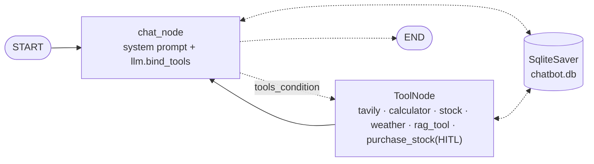

# 06 · Agentic Chatbot with LangGraph

> **Notes:** [13](../../docs/notes/13-first-agentic-chatbot.md) → [23](../../docs/notes/23-deployment-render.md) · **Diagrams:** [`13-agentic-chatbot`](../../docs/diagrams/13-agentic-chatbot.excalidraw) · [`21-agentic-chatbot-hitl`](../../docs/diagrams/21-agentic-chatbot-hitl.excalidraw)

One Streamlit chatbot built up over **ten chapters**. Every stage is kept as its own backend / frontend pair, so you can run and diff any step.



## Stage map

| Stage | Backend | Frontend (`streamlit run …`) | Adds | Note |
|---|---|---|---|---|
| 1 | [`agentic_chatbot_backend.py`](agentic_chatbot_backend.py) | [`non_stream.py`](non_stream.py) | `chat_node` + `MemorySaver`, `invoke` | [13](../../docs/notes/13-first-agentic-chatbot.md) |
| 2 | ″ | [`app_simple.py`](app_simple.py) · [`test.py`](test.py) (CLI) | Token **streaming** | [15](../../docs/notes/15-streaming-responses.md) |
| 3 | ″ | [`app_thread.py`](app_thread.py) | **Threads** sidebar: new chat / resume | [16](../../docs/notes/16-chat-threading.md) |
| 4 | [`agentic_chatbot_db_backend.py`](agentic_chatbot_db_backend.py) | [`app_db.py`](app_db.py) | **SQLite** permanent memory + **LangSmith** thread metadata | [17](../../docs/notes/17-database-persistence.md) · [18](../../docs/notes/18-langsmith-monitoring.md) |
| 5 | [`agentic_chatbot_tool_backend.py`](agentic_chatbot_tool_backend.py) | [`app_tool.py`](app_tool.py) | **Tools** + "🔧 Using tool…" status | [19](../../docs/notes/19-tool-integration.md) |
| 6 | [`agentic_chatbot_rag_backend.py`](agentic_chatbot_rag_backend.py) | [`app_rag.py`](app_rag.py) | **RAG**: PDF upload → FAISS → `rag_tool` | [20](../../docs/notes/20-rag-in-chatbot.md) |
| 7 | [`agentic_chatbot_hitl_backend.py`](agentic_chatbot_hitl_backend.py) | [`app_hitl.py`](app_hitl.py) | **HITL** `purchase_stock` with Approve / Reject | [21](../../docs/notes/21-human-in-the-loop.md) |
| CLI | [`chatbot_without_hitl.py`](chatbot_without_hitl.py) · [`chatbot_with_hitl.py`](chatbot_with_hitl.py) | `python …` | Before / after HITL in the terminal | [21](../../docs/notes/21-human-in-the-loop.md) |

Notebooks: [`Chatbot_workflow`](notebooks/Chatbot_workflow.ipynb) · [`tools_demo`](notebooks/tools_demo.ipynb) · [`rag_demo`](notebooks/rag_demo.ipynb) (uses [`my_paper.pdf`](notebooks/my_paper.pdf)) · [`HITL_demo`](notebooks/HITL_demo.ipynb).

## Run

```bash
conda create -n langgraph-test python=3.11 -y && conda activate langgraph-test
pip install -r requirements.txt
cp .env.example .env
# GOOGLE_API_KEY (Gemini, used by stages 4–7) or OPENAI_API_KEY (stages 1–3)
# TAVILY_API_KEY · OPENWEATHER_API_KEY · ALPHAVANTAGE_API_KEY · LANGSMITH_*
streamlit run app_hitl.py           # final version
```

> [!IMPORTANT]
> **Generated at runtime and git-ignored:** `chatbot.db*` (all conversations) and `faiss_db/` (the RAG index, rebuilt on first PDF upload). The upstream copies were **not** included: one contains the author's chat history, and the other is a pickle loaded with `allow_dangerous_deserialization=True`.

> [!CAUTION]
> Upstream hard-coded an Alpha Vantage API key in `get_stock_price`. Here every copy reads `os.getenv('ALPHAVANTAGE_API_KEY')`.

## Deployment

The Dockerfile and the GitHub Actions → Docker Hub → EC2 workflow live in the instructor's deploy repo [entbappy/Agentic-Chatbot-using-LangGraph](https://github.com/entbappy/Agentic-Chatbot-using-LangGraph). They are walked through in [22 · AWS CI/CD](../../docs/notes/22-cicd-deployment-aws.md) and [23 · Render](../../docs/notes/23-deployment-render.md).
