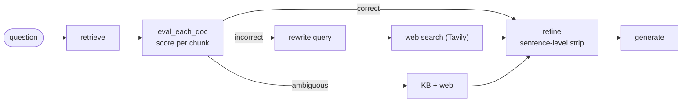
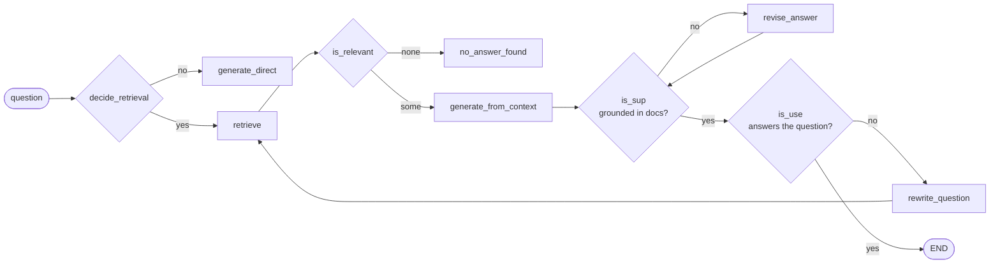
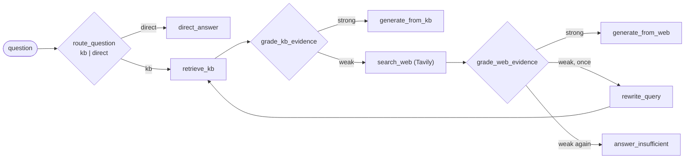
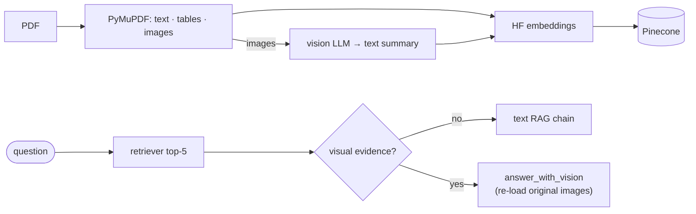

# 07 · Advanced RAG

> **Not covered in the video.** These are extra modules from the course repository that extend [20 · RAG in the chatbot](../../docs/notes/20-rag-in-chatbot.md). **Slides:** [`graph-rag-neo4j.pdf`](../../docs/slides/graph-rag-neo4j.pdf) · [`multimodal-rag-pinecone.pdf`](../../docs/slides/multimodal-rag-pinecone.pdf)

Plain RAG trusts whatever the retriever returns. Each pattern below adds a **decision step** (graded with structured LLM output and routed with LangGraph conditional edges) to make retrieval more reliable.

| Folder | Pattern | Vector / graph store | LLM | Keys |
|---|---|---|---|---|
| [`corrective-rag/`](corrective-rag/) | **CRAG**: grade retrieved docs, fix or fall back to web | FAISS | OpenAI | `OPENAI_API_KEY`, `TAVILY_API_KEY` |
| [`self-rag/`](self-rag/) | **Self-RAG**: decide *whether* to retrieve, then critique the answer | FAISS | OpenAI | `OPENAI_API_KEY`, `TAVILY_API_KEY` |
| [`agentic-rag/`](agentic-rag/) | **Agentic RAG**: route, grade KB, web fallback, rewrite, answer | Pinecone (384-d HF embeddings) | Groq | `GROQ_API_KEY`, `PINECONE_API_KEY`, `TAVILY_API_KEY` |
| [`graph-rag/`](graph-rag/) | **GraphRAG**: LLM-extracted knowledge graph + Cypher QA | Neo4j Aura | Groq | `GROQ_API_KEY`, `NEO4J_*` |
| [`multimodal-rag/`](multimodal-rag/) | **Multimodal RAG**: text + tables + images from a PDF | Pinecone | Groq (+ vision) | `GROQ_API_KEY`, `PINECONE_API_KEY` |

Each folder has its own `requirements.txt` and `.env.example`.

---

## Corrective RAG (CRAG)

Built up in seven notebooks, `1_basic_rag` → `final_CRAG`. Paper: [arXiv:2401.15884](https://arxiv.org/abs/2401.15884). The source book link is in [`documents/book link.txt`](corrective-rag/documents/book%20link.txt).

| Notebook | Adds |
|---|---|
| `1_basic_rag` | `retrieve → generate` baseline |
| `2_retrieval_refinement` | Split chunks into sentences and keep only relevant ones |
| `3_retrieval_evaluator` | LLM grades each doc: correct / incorrect / ambiguous |
| `4_web_search_refinement` | Tavily fallback when the KB fails |
| `5_query_rewrite` | Rewrite the question before web search |
| `6_ambiguous` | Merge KB and web evidence for the ambiguous case |
| `final_CRAG` | Everything combined |

## Self-RAG

Six steps plus a web variant in `self_rag_step1` → `self_rag_final` / `self_rag_web`, over three sample company PDFs in [`self-rag/documents/`](self-rag/documents/).

`self_rag_web` swaps the dead end for a fallback: when `is_relevant` finds nothing, run `rewrite_query` then `web_search` (Tavily), and generate from the web results.

## Agentic RAG (industry style)

The private KB is LangGraph's own *agentic-rag* docs page, chunked and embedded with free local Hugging Face embeddings into a **Pinecone** index (dimension 384).

> [!TIP]
> Why *private KB first*: company questions should not leak to a public search engine unless the internal evidence is actually insufficient.

## GraphRAG with Neo4j

**Documents → chunking → `LLMGraphTransformer` (Person, Movie, Genre; DIRECTED, ACTED_IN, IN_GENRE) → Neo4j → `GraphCypherQAChain`.** The chain turns the question into Cypher, runs it, and has the LLM phrase the answer. GraphRAG **traverses relationships** (*"every actor in every movie this director made"*), where vector similarity search would struggle. [`Cypher-Query.md`](graph-rag/Cypher-Query.md) has the hand-written `CREATE` / `MATCH` examples.

> [!NOTE]
> The notebook contains placeholder credentials (`your_neo4j_connection_string`, `your_groq_api_key`). Load them from `.env` instead of editing the cells.

## Multimodal RAG (NovaCore report)

[`NovaCore_Multimodal_Company_Report_2026.pdf`](multimodal-rag/NovaCore_Multimodal_Company_Report_2026.pdf) is a sample company report that mixes text, tables and charts.

Demos cover a text question, a table lookup, a revenue graph, a supply-chain diagram, a support-resolution chart, a sustainability chart and a cross-modal question.
